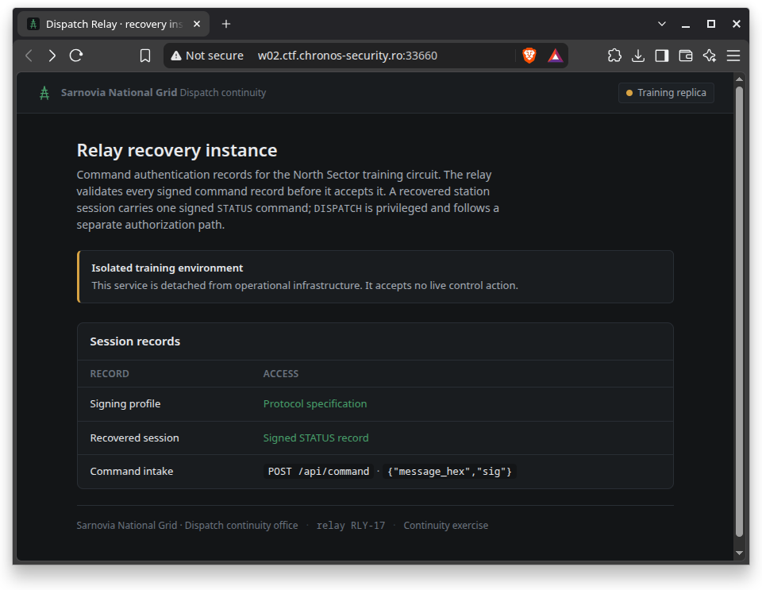
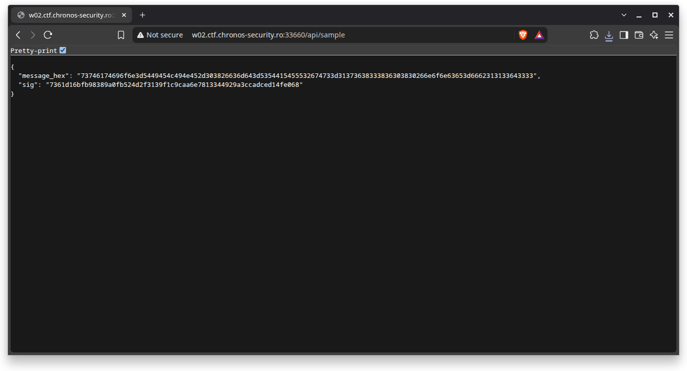
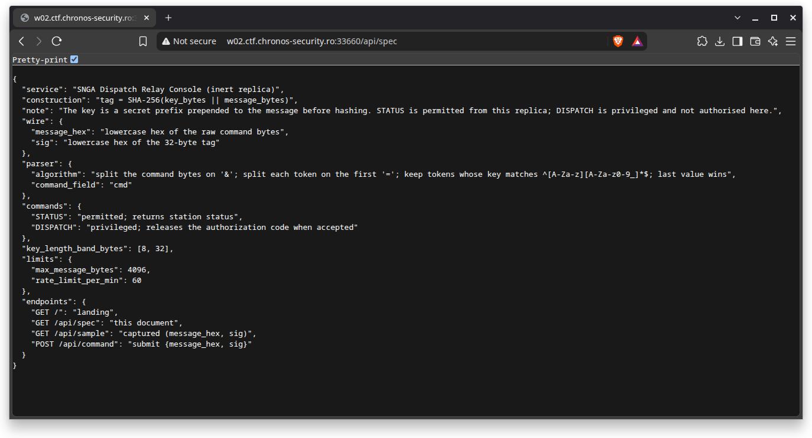
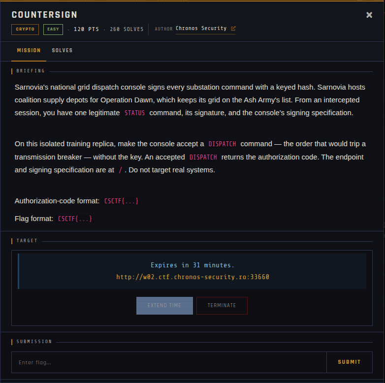

# COUNTERSIGN

| | |
|---|---|
| **Competition** | CSCTF 2026 |
| **Category** | Crypto |
| **Points** | 120 |
| **Author** | Chronos Security |
| **Difficulty** | Easy |
| **Solves** | 260 |

## Description

> Sarnovia's national grid dispatch console signs every substation command with a keyed hash. Sarnovia hosts coalition supply depots for Operation Dawn, which keeps its grid on the Ash Army's list. From an intercepted session, you have one legitimate STATUS command, its signature, and the console's signing specification.
>
> On this isolated training replica, make the console accept a DISPATCH command — the order that would trip a transmission breaker — without the key. An accepted DISPATCH returns the authorization code. The endpoint and signing specification are at `/`. Do not target real systems.
>
> Authorization-code format: `CSCTF{...}`
> Flag format: `CSCTF{...}`

## Files

| File | Notes |
|------|-------|
| `files/sample.json` | Captured `{message_hex, sig}` pair for a legitimate STATUS command |
| `files/spec.json` | Console signing specification (`tag = SHA-256(key_bytes \|\| message_bytes)`, parser rules, command list) |

## Remote service

Offline since the event ended. It was hosted at `w02.ctf.chronos-security.ro:33660` with:
- `GET /` — landing page
- `GET /api/spec` — signing specification
- `GET /api/sample` — captured `{message_hex, sig}`
- `POST /api/command` — submit `{message_hex, sig}`

## Screenshots

## Solve

⚠️ Spoilers: solve script and notes

The server authenticates commands with `tag = SHA-256(key_bytes || message_bytes)`, a secret-prefix MAC construction that's vulnerable to a **SHA-256 length-extension attack**. Given one valid `(message, sig)` pair for a `STATUS` command, you can forge a valid signature for `message || padding || &cmd=DISPATCH` without knowing the secret key, since the attacker can resume SHA-256's internal state from the leaked digest. The script brute-forces the key length within the spec's declared `key_length_band_bytes` range (8–32), computes the correct padding for each guess, appends `&cmd=DISPATCH`, and extends the hash accordingly until the server accepts a forged request.

- Solve script: [`solve/solve.py`](solve/solve.py)
- Flag: *(not provided)*
- Write-up: —

---
Source: CSCTF 2026 · Chronos Security
Archived by [StrayHound](https://strayhound.team) 🐾
