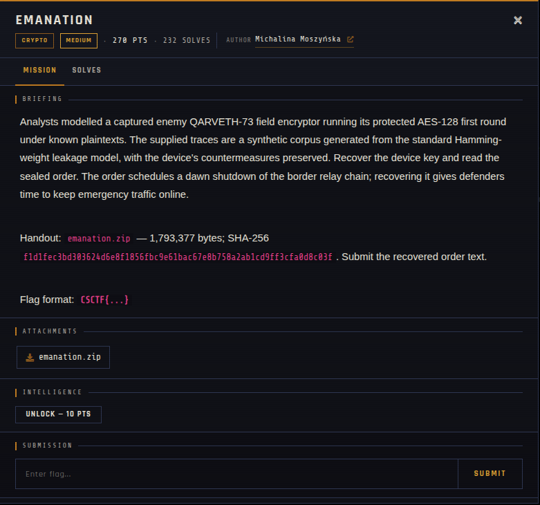

# EMANATION

| | |
|---|---|
| **Competition** | CSCTF 2026 |
| **Category** | Crypto |
| **Points** | 270 |
| **Author** | Michalina Moszyńska |
| **Difficulty** | Medium |
| **Solves** | 232 |

## Description

> Analysts modelled a captured enemy QARVETH-73 field encryptor running its protected AES-128 first round under known plaintexts. The supplied traces are a synthetic corpus generated from the standard Hamming-weight leakage model, with the device's countermeasures preserved. Recover the device key and read the sealed order. The order schedules a dawn shutdown of the border relay chain; recovering it gives defenders time to keep emergency traffic online.
>
> Handout: `emanation.zip` — 1,793,377 bytes; SHA-256 `f1d1fec3bd303624d6e8f1856fbc9e61bac67e8b758a2ab1cd9ff3cfa0d8c03f`. Submit the recovered order text.
>
> Flag format: `CSCTF{...}`

## Files

| File | Notes |
|------|-------|
| `files/emanation.zip` | Handout — synthetic power-trace corpus for a modelled AES-128 (Hamming-weight leakage model), 1,793,377 bytes |

## Remote service

Fully offline — no live server, challenge was handout-only.

## Screenshots

## Solve

⚠️ Spoilers: notes

This is a side-channel power-analysis challenge: recover the AES-128 key for a modelled device from the first-round Hamming-weight leakage traces in the handout (e.g. via correlation power analysis / DPA against the SubBytes output), then use the key to decrypt the sealed order.

- Solve script: *(none provided — not solved/archived yet)*
- Flag: *(not provided)*
- Write-up: —

---
Source: CSCTF 2026 · Michalina Moszyńska
Archived by [StrayHound](https://strayhound.team) 🐾
