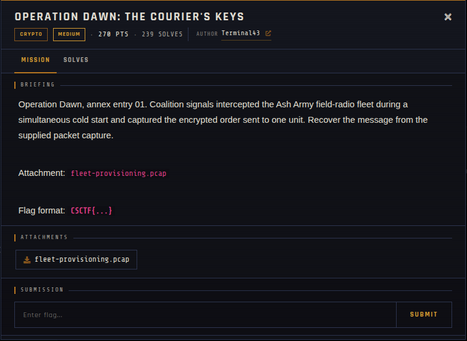

# Operation Dawn: The Courier's Keys

| | |
|---|---|
| **Competition** | CSCTF 2026 |
| **Category** | Crypto |
| **Points** | 270 |
| **Author** | Terminal43 |
| **Difficulty** | Medium |
| **Solves** | 239 |

## Description

> Operation Dawn, annex entry 01. Coalition signals intercepted the Ash Army field-radio fleet during a simultaneous cold start and captured the encrypted order sent to one unit. Recover the message from the supplied packet capture.
>
> Attachment: `fleet-provisioning.pcap`
>
> Flag format: `CSCTF{...}`

## Files

| File | Notes |
|------|-------|
| `files/fleet-provisioning.pcap` | Packet capture of the fleet's simultaneous cold-start / provisioning traffic |

## Remote service

Fully offline — no live server, challenge was handout-only.

## Screenshots

## Solve

⚠️ Spoilers: notes

"Simultaneous cold start" is the giveaway: multiple radios in the fleet provisioned at once, suggesting reused/weak randomness (e.g. a shared or low-entropy key/IV/nonce across units) at boot. The approach is to pull the relevant crypto handshake/traffic out of the pcap and look for key or nonce reuse across the fleet to recover the encrypted order.

- Solve script: *(none provided — not solved/archived yet)*
- Flag: *(not provided)*
- Write-up: —

---
Source: CSCTF 2026 · Terminal43
Archived by [StrayHound](https://strayhound.team) 🐾
