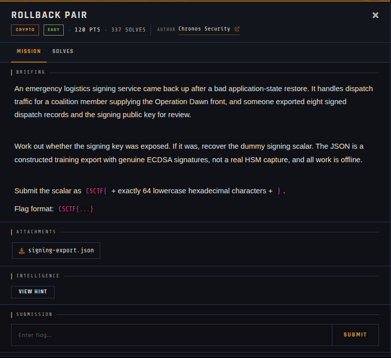
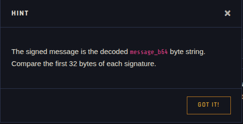

# ROLLBACK PAIR

| | |
|---|---|
| **Competition** | CSCTF 2026 |
| **Category** | Crypto |
| **Points** | 120 |
| **Author** | Chronos Security |
| **Difficulty** | Easy |
| **Solves** | 337 |

## Description

> An emergency logistics signing service came back up after a bad application-state restore. It handles dispatch traffic for a coalition member supplying the Operation Dawn front, and someone exported eight signed dispatch records and the signing public key for review.
>
> Work out whether the signing key was exposed. If it was, recover the dummy signing scalar. The JSON is a constructed training export with genuine ECDSA signatures, not a real HSM capture, and all work is offline.
>
> Submit the scalar as `CSCTF{` + exactly 64 lowercase hexadecimal characters + `}`.
> Flag format: `CSCTF{...}`

## Files

| File | Notes |
|------|-------|
| `files/signing-export.json` | Eight signed dispatch records plus the ECDSA signing public key |

## Remote service

Fully offline — no live server, challenge was handout-only.

## Screenshots

## Solve

⚠️ Spoilers: notes

"Bad application-state restore" is the tell: a rolled-back signing service likely reused a per-signature nonce (`k`) across two or more ECDSA signatures. Per the hint, the signed message is the base64-decoded `message_b64` byte string, and the first 32 bytes of each signature should be compared to spot a repeated `r` (i.e. a repeated nonce). Once a nonce-reuse pair is found, the private key can be recovered algebraically from the two `(r, s, z)` triples (`k = (z1 - z2) / (s1 - s2) mod n`, then `d = (s1*k - z1) / r mod n`), matching the recovery formula later reused in the related `signing-authority` challenge.

- Solve script: *(none provided — not solved/archived yet)*
- Flag: *(not provided)*
- Write-up: —

---
Source: CSCTF 2026 · Chronos Security
Archived by [StrayHound](https://strayhound.team) 🐾
