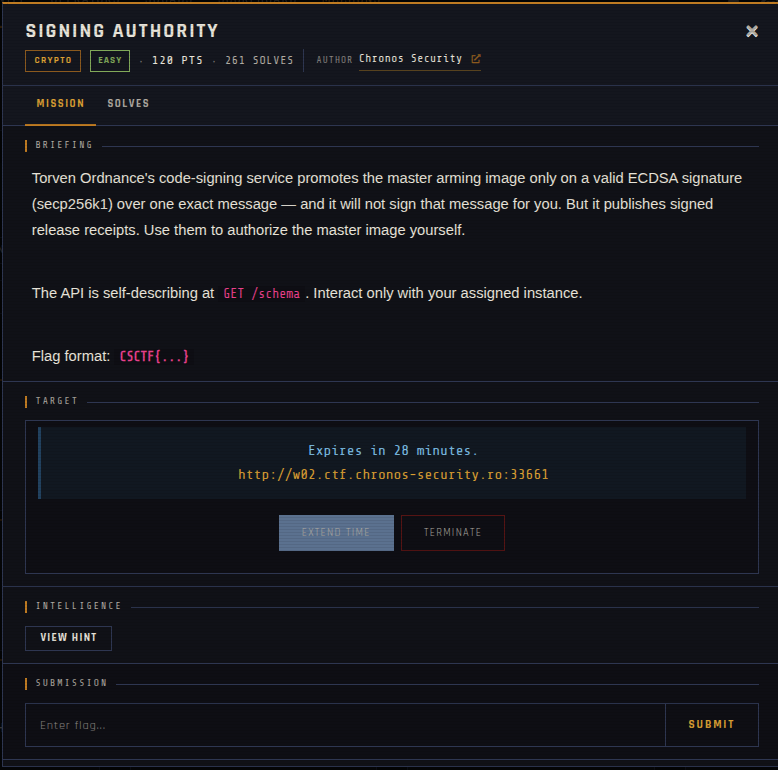
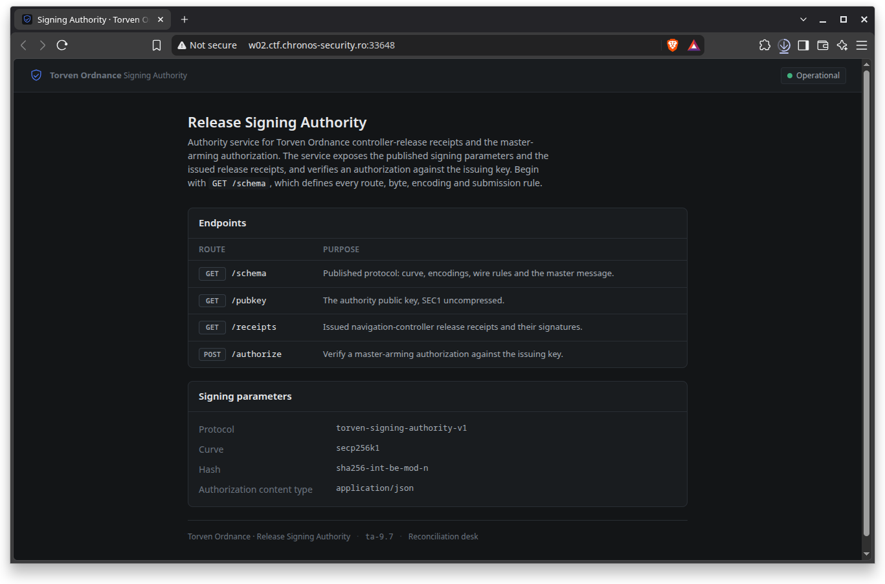
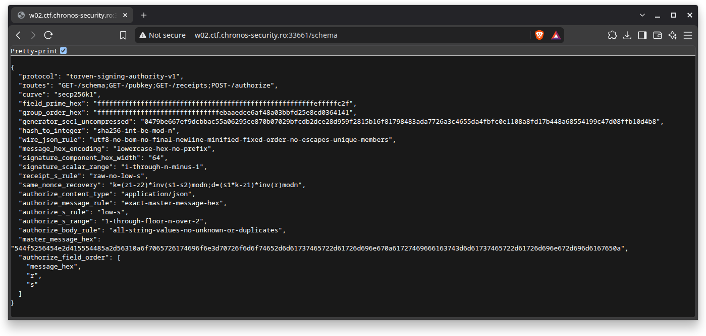
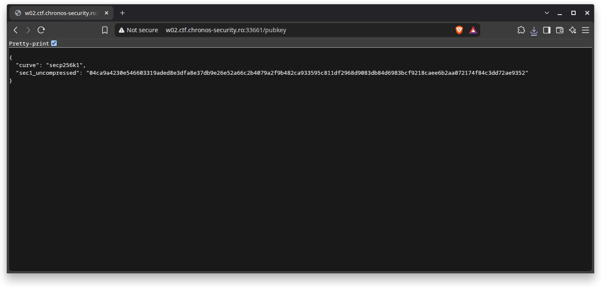
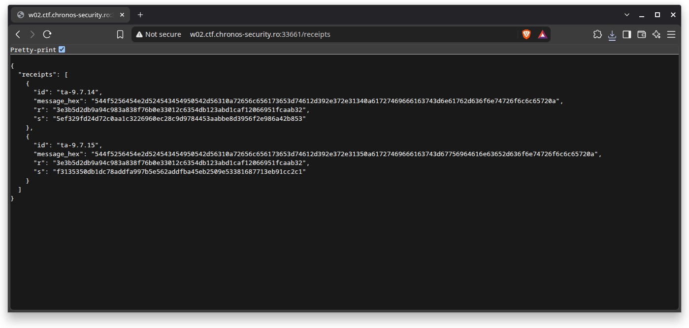

# SIGNING AUTHORITY

| | |
|---|---|
| **Competition** | CSCTF 2026 |
| **Category** | Crypto |
| **Points** | 120 |
| **Author** | Chronos Security |
| **Difficulty** | Easy |
| **Solves** | 261 |

## Description

> Torven Ordnance's code-signing service promotes the master arming image only on a valid ECDSA signature (secp256k1) over one exact message — and it will not sign that message for you. But it publishes signed release receipts. Use them to authorize the master image yourself.
>
> The API is self-describing at `GET /schema`. Interact only with your assigned instance.
>
> Flag format: `CSCTF{...}`

## Files

| File | Notes |
|------|-------|
| `files/schema.json` | Published protocol: curve (secp256k1), field/order, encodings, wire rules, and the exact master message to authorize |
| `files/pubkey.json` | Authority public key, SEC1 uncompressed |
| `files/receipts.json` | Issued navigation-controller release receipts and their ECDSA signatures |

## Remote service

Offline since the event ended. It was a per-team instance at `w02.ctf.chronos-security.ro:33661`, with:
- `GET /schema` — published protocol: curve, encodings, wire rules and the master message
- `GET /pubkey` — the authority public key, SEC1 uncompressed
- `GET /receipts` — issued navigation-controller release receipts and their signatures
- `POST /authorize` — verify a master-arming authorization against the issuing key

## Screenshots

## Solve

⚠️ Spoilers: solve scripts and notes

The authority will never sign the privileged "promote master arming image" message directly, but it publishes a batch of release receipts signed with the same key. `schema.json` reveals several receipts share the same `r` value — the classic signature of **ECDSA nonce reuse**. From any two receipts that reuse a nonce, the signing scalar `d` can be recovered with `k = (z1 - z2) * inv(s1 - s2) mod n` then `d = (s1*k - z1) * inv(r) mod n` (this is the same recovery given directly in `schema.json`'s `same_nonce_recovery` field). Once `d` is known, forge a fresh low-`s` ECDSA signature over `master_message_hex` and submit `{message_hex, r, s}` to `POST /authorize`.

- Solve script (nonce-reuse key recovery): [`solve/solve.py`](solve/solve.py)
- Solve script (forge + submit authorization): [`solve/solve2.py`](solve/solve2.py)
- Flag: *(not provided)*
- Write-up: —

**Note:** both scripts point at an ephemeral per-team instance (`w01.ctf.chronos-security.ro:34447`), which will differ from whatever instance you're assigned — update the `base_url` before reuse.

---
Source: CSCTF 2026 · Chronos Security
Archived by [StrayHound](https://strayhound.team) 🐾
