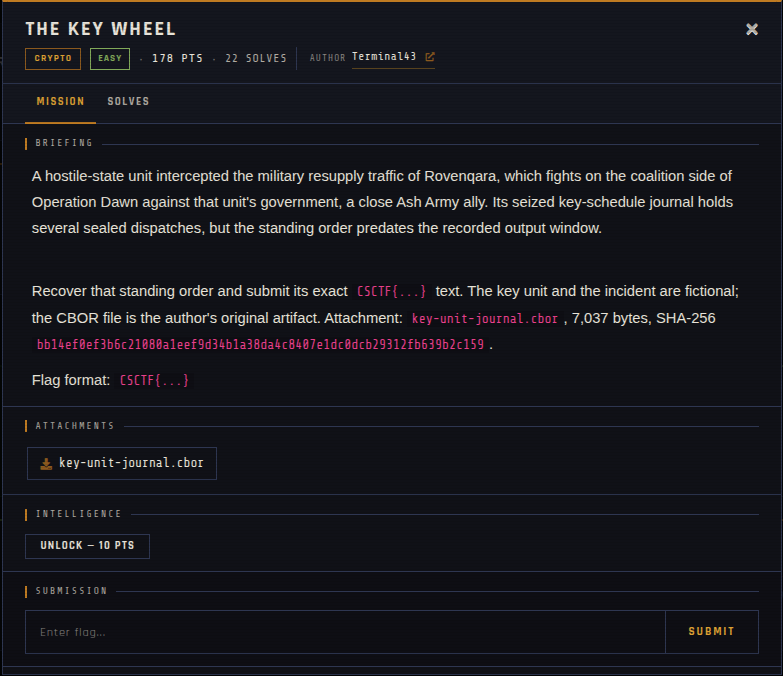

# THE KEY WHEEL

| | |
|---|---|
| **Competition** | CSCTF 2026 |
| **Category** | Crypto |
| **Points** | 178 |
| **Author** | Terminal43 |
| **Difficulty** | Easy |
| **Solves** | 22 |

## Description

> A hostile-state unit intercepted the military resupply traffic of Rovenqara, which fights on the coalition side of Operation Dawn against that unit's government, a close Ash Army ally. Its seized key-schedule journal holds several sealed dispatches, but the standing order predates the recorded output window.
>
> Recover that standing order and submit its exact `CSCTF{...}` text. The key unit and the incident are fictional; the CBOR file is the author's original artifact. Attachment: `key-unit-journal.cbor`, 7,037 bytes, SHA-256 `bb14ef0ef3b6c21080a1eef9d34b1a38da4c8407e1dc0dcb29312fb639b2c159`.
>
> Flag format: `CSCTF{...}`

## Files

| File | Notes |
|------|-------|
| `files/key-unit-journal.cbor` | Seized key-schedule journal (CBOR), 7,037 bytes |

## Remote service

Fully offline — no live server, challenge was handout-only.

## Screenshots

## Solve

⚠️ Spoilers: notes

The standing order "predates the recorded output window" of a key-schedule/keystream journal — the task is to roll the key-schedule/PRNG state backward from the earliest recorded entry to regenerate the keystream (or key) used before logging began, then decrypt the sealed standing order with it.

- Solve script: *(none provided — not solved/archived yet)*
- Flag: *(not provided)*
- Write-up: —

---
Source: CSCTF 2026 · Terminal43
Archived by [StrayHound](https://strayhound.team) 🐾
