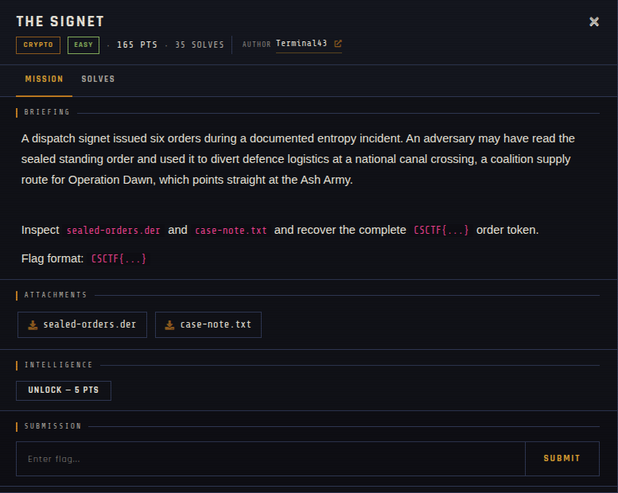

# THE SIGNET

| | |
|---|---|
| **Competition** | CSCTF 2026 |
| **Category** | Crypto |
| **Points** | 165 |
| **Author** | Terminal43 |
| **Difficulty** | Easy |
| **Solves** | 35 |

## Description

> A dispatch signet issued six orders during a documented entropy incident. An adversary may have read the sealed standing order and used it to divert defence logistics at a national canal crossing, a coalition supply route for Operation Dawn, which points straight at the Ash Army.
>
> Inspect `sealed-orders.der` and `case-note.txt` and recover the complete `CSCTF{...}` order token.
>
> Flag format: `CSCTF{...}`

## Files

| File | Notes |
|------|-------|
| `files/sealed-orders.der` | DER-encoded `SignetBundle`: signer SPKI, six signed orders, and the sealed standing order |
| `files/case-note.txt` | Case/format note — ASN.1 schema, signing parameters, and the HKDF/AES-256-GCM sealing recipe for the standing order |

## Remote service

Fully offline — no live server, challenge was handout-only.

## Screenshots

## Solve

⚠️ Spoilers: notes

`case-note.txt` spells out the construction in full: an ECDSA (secp256k1) signer whose per-signature nonce was a faulty additive-stride counter during the incident ("each consecutive signing operation consumed the next temporary scalar-register value... the same additive stride modulo the curve order"). With six signed orders (`seq 0..5`) sharing this biased/linear nonce relationship, the signing private key `d` can be recovered by setting up and solving the linear relations between consecutive `(r, s, z)` triples for the unknown starting nonce and stride. Once `d` is recovered, derive `key = HKDF-SHA-256(I2OSP(d,32), salt=seal.salt, info="CSCTF26/TheSignet/v1/standing-order", L=32)` and decrypt `seal.ciphertext` with AES-256-GCM (`seal.nonce`, `seal.tag`, empty AAD) to get the flag.

- Solve script: *(none provided — not solved/archived yet)*
- Flag: *(not provided)*
- Write-up: —

---
Source: CSCTF 2026 · Terminal43
Archived by [StrayHound](https://strayhound.team) 🐾
