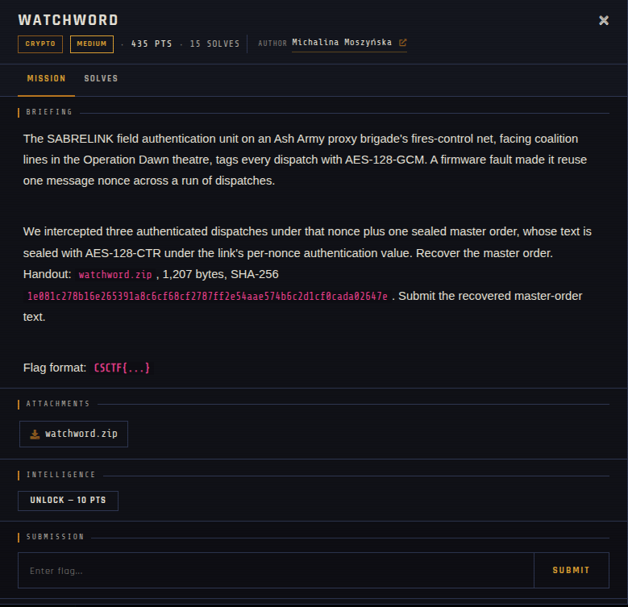

# WATCHWORD

| | |
|---|---|
| **Competition** | CSCTF 2026 |
| **Category** | Crypto |
| **Points** | 435 |
| **Author** | Michalina Moszyńska |
| **Difficulty** | Medium |
| **Solves** | 15 |

## Description

> The SABRELINK field authentication unit on an Ash Army proxy brigade's fires-control net, facing coalition lines in the Operation Dawn theatre, tags every dispatch with AES-128-GCM. A firmware fault made it reuse one message nonce across a run of dispatches.
>
> We intercepted three authenticated dispatches under that nonce plus one sealed master order, whose text is sealed with AES-128-CTR under the link's per-nonce authentication value. Recover the master order.
> Handout: `watchword.zip`, 1,207 bytes, SHA-256 `1e081c278b16e265391a8c6cf68cf2787ff2e54aae574b6c2d1cf0cada02647e`. Submit the recovered master-order text.
>
> Flag format: `CSCTF{...}`

## Files

| File | Notes |
|------|-------|
| `files/watchword.zip` | Handout — three AES-128-GCM dispatches under a reused nonce, plus the AES-128-CTR-sealed master order, 1,207 bytes |

## Remote service

Fully offline — no live server, challenge was handout-only.

## Screenshots

## Solve

⚠️ Spoilers: notes

This is GCM nonce reuse: with the same (key, nonce) pair used across multiple AES-GCM messages, the GHASH authentication subkey `H` and the keystream block can be recovered from the known/intercepted ciphertext–tag pairs via the standard GCM forbidden-attack polynomial algebra. Once the per-nonce keystream/authentication value is recovered, it's used (per the brief) as the key material for decrypting the separately AES-128-CTR-sealed master order.

- Solve script: *(none provided — not solved/archived yet)*
- Flag: *(not provided)*
- Write-up: —

---
Source: CSCTF 2026 · Michalina Moszyńska
Archived by [StrayHound](https://strayhound.team) 🐾
