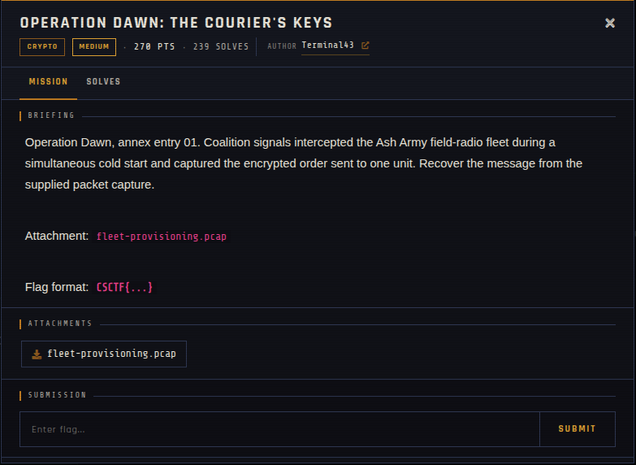

# Operation Dawn: The Courier's Keys

| | |
|---|---|
| **Competition** | CSCTF 2026 |
| **Category** | Crypto |
| **Points** | 270 |
| **Author** | Terminal43 |
| **Difficulty** | Medium |
| **Solves** | 239 |

## Description

> Operation Dawn, annex entry 01. Coalition signals intercepted the Ash Army field-radio fleet during a simultaneous cold start and captured the encrypted order sent to one unit. Recover the message from the supplied packet capture.
>
> Attachment: `fleet-provisioning.pcap`
>
> Flag format: `CSCTF{...}`

## Files

| File | Notes |
|------|-------|
| `files/fleet-provisioning.pcap` | Packet capture of the fleet's simultaneous cold-start / provisioning traffic |

## Remote service

Fully offline — no live server, challenge was handout-only.

## Screenshots



## Solve

<details>
<summary>⚠️ Spoilers: solve script and notes</summary>

"Simultaneous cold start" is the giveaway, but the real weakness isn't shared randomness — it's a broadcast packet in the pcap that spells out the unit's own keygen spec in plaintext:

```
ASH ARMY KEY UNIT :: provisioning profile
on power-up each set derives its key from the boot clock and its set serial:
  seed = (power_up_epoch_seconds << 16) | serial
  generator = MT19937 seeded with that value
  draw two 512-bit primes in turn: take a 512-bit candidate with top and bottom
  bits set, keep the first that is prime; these are p then q
  modulus N = p * q, public exponent 65537
```

Each unit broadcasts `REG serial=... e=65537 N=...` in the clear, and the intercepted order shows up as `ORDER serial=6631 C=...`.

The primes are generated with Python's `random` module (MT19937), which is not a CSPRNG. The only unknown in the seed is the boot epoch — the serial is broadcast in the clear, and the epoch can't be far from the packet's own capture timestamp. That collapses the keyspace to a brute-forceable window.

Attack:
1. Extract the `REG`/`ORDER` payloads from the pcap.
2. For the target unit (serial `6631`), brute-force candidate boot epochs in a window around that unit's own `REG` packet arrival time (±10 minutes was plenty — the real offset was 3 seconds).
3. For each candidate epoch, replicate the device's own keygen exactly (seed MT19937, draw 512-bit candidates with forced top+bottom bits, keep the first prime) to regenerate `p, q`, and check whether `p*q` matches the broadcast `N`.
4. On a match, compute `d = e⁻¹ mod φ(N)` and decrypt: `m = C^d mod N`.

Solve scripts: [`solve/step1_extract.py`](solve/step1_extract.py) (pulls the REG/ORDER payloads from the pcap), [`solve/step2_solve.py`](solve/step2_solve.py) (brute-forces the epoch, recovers `p, q`, decrypts `C`)

Flag: `CSCTF{01_advance_on_the_mill_a7c3f1}`

</details>

---
Source: CSCTF 2026 · Terminal43
Archived by [StrayHound](https://strayhound.team) 🐾