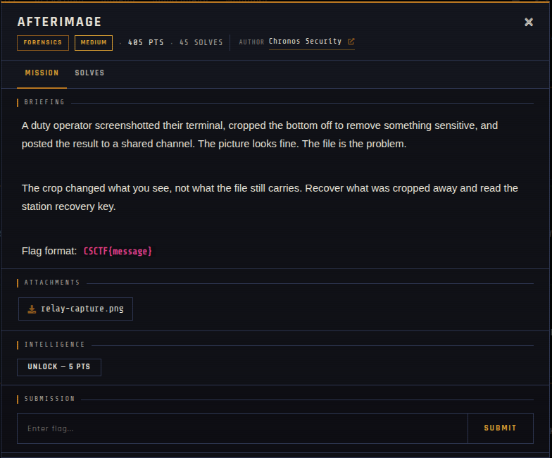

# Afterimage 🐾

| | |
|---|---|
| **Competition** | CSCTF 2026 |
| **Category** | Forensics |
| **Points** | 270 |
| **Author** | Chronos Security |
| **Difficulty** | Medium |
| **Solves** | 45 (at time of capture) |

## Description

> A duty operator screenshotted their terminal, cropped the bottom off to remove something sensitive, and posted the result to a shared channel. The picture looks fine. The file is the problem.
>
> The crop changed what you see, not what the file still carries. Recover what was cropped away and read the station recovery key.
>
> Flag format: `CSCTF{message}`

## Files

> ⚠️ Forensic material: open it only inside a VM and never run anything it contains.

| File | Notes |
|------|-------|
| `files/relay-capture.png` | PNG image (520 x 340), 26,174 bytes |

## Screenshots

---
Source: CSCTF 2026 · Chronos Security
Archived by [StrayHound](https://strayhound.team) 🐾
