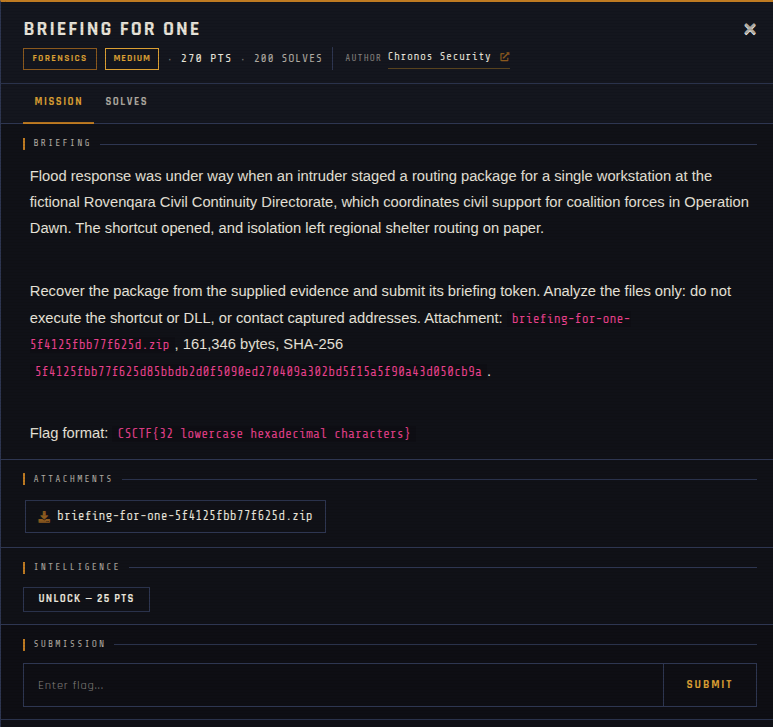

# Briefing for One 🐾

| | |
|---|---|
| **Competition** | CSCTF 2026 |
| **Category** | Forensics |
| **Points** | 270 |
| **Author** | Chronos Security |
| **Difficulty** | Medium |
| **Solves** | 200 (at time of capture) |

## Description

> Flood response was under way when an intruder staged a routing package for a single workstation at the fictional Rovenqara Civil Continuity Directorate, which coordinates civil support for coalition forces in Operation Dawn. The shortcut opened, and isolation left regional shelter routing on paper.
>
> Recover the package from the supplied evidence and submit its briefing token. Analyze the files only: do not execute the shortcut or DLL, or contact captured addresses. Attachment: `briefing-for-one-5f4125fbb77f625d.zip`, 161,346 bytes, SHA-256 `5f4125fbb77f625d85bbdb2d0f5090ed270409a302bd5f15a5f90a43d050cb9a`.
>
> Flag format: `CSCTF{32 lowercase hexadecimal characters}`

## Files

> ⚠️ Forensic material: open it only inside a VM and never run anything it contains.

| File | Notes |
|------|-------|
| `files/briefing-for-one-5f4125fbb77f625d.zip` | Challenge archive, 161,346 bytes |

## Screenshots

---
Source: CSCTF 2026 · Chronos Security
Archived by [StrayHound](https://strayhound.team) 🐾
