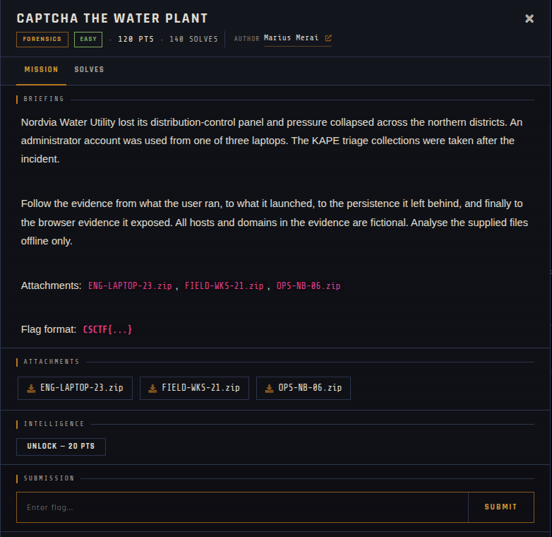

# CAPTCHA the Water Plant 🐾

| | |
|---|---|
| **Competition** | CSCTF 2026 |
| **Category** | Forensics |
| **Points** | 120 |
| **Author** | Marius Merai |
| **Difficulty** | Easy |
| **Solves** | 140 (at time of capture) |

## Description

> Nordvia Water Utility lost its distribution-control panel and pressure collapsed across the northern districts. An administrator account was used from one of three laptops. The KAPE triage collections were taken after the incident.
>
> Follow the evidence from what the user ran, to what it launched, to the persistence it left behind, and finally to the browser evidence it exposed. All hosts and domains in the evidence are fictional. Analyse the supplied files offline only.
>
> Attachments: `ENG-LAPTOP-23.zip`, `FIELD-WKS-21.zip`, `OPS-NB-06.zip`
>
> Flag format: `CSCTF{...}`

## Files

> ⚠️ Forensic material: open it only inside a VM and never run anything it contains.

| File | Notes |
|------|-------|
| `files/ENG-LAPTOP-23.zip` | KAPE triage collection |
| `files/FIELD-WKS-21.zip` | KAPE triage collection |
| `files/OPS-NB-06.zip` | KAPE triage collection |

## Screenshots

---
Source: CSCTF 2026 · Marius Merai
Archived by [StrayHound](https://strayhound.team) 🐾
