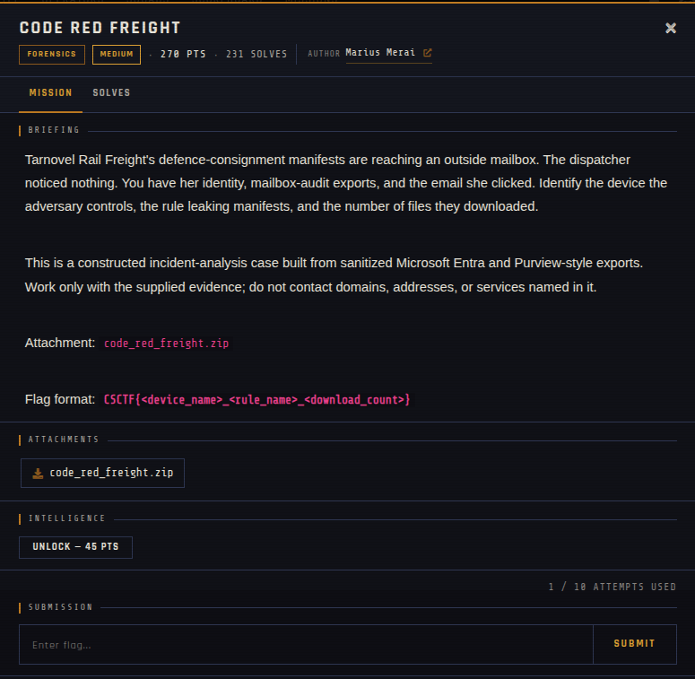

# Code Red Freight 🐾

| | |
|---|---|
| **Competition** | CSCTF 2026 |
| **Category** | Forensics |
| **Points** | 270 |
| **Author** | Marius Merai |
| **Difficulty** | Medium |
| **Solves** | 231 (at time of capture) |

## Description

> Tarnovel Rail Freight's defence-consignment manifests are reaching an outside mailbox. The dispatcher noticed nothing. You have her identity, mailbox-audit exports, and the email she clicked. Identify the device the adversary controls, the rule leaking manifests, and the number of files they downloaded.
>
> This is a constructed incident-analysis case built from sanitized Microsoft Entra and Purview-style exports. Work only with the supplied evidence; do not contact domains, addresses, or services named in it.
>
> Attachment: `code_red_freight.zip`
>
> Flag format: `CSCTF{<device_name>_<rule_name>_<download_count>}`

## Files

> ⚠️ Forensic material: open it only inside a VM and never run anything it contains.

| File | Notes |
|------|-------|
| `files/code_red_freight.zip` | Challenge archive, 251,022 bytes |

## Screenshots

---
Source: CSCTF 2026 · Marius Merai
Archived by [StrayHound](https://strayhound.team) 🐾
