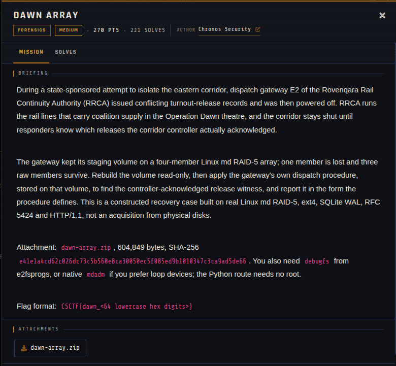

# Dawn Array 🐾

| | |
|---|---|
| **Competition** | CSCTF 2026 |
| **Category** | Forensics |
| **Points** | 270 |
| **Author** | Chronos Security |
| **Difficulty** | Medium |
| **Solves** | 221 (at time of capture) |

## Description

> During a state-sponsored attempt to isolate the eastern corridor, dispatch gateway E2 of the Rovenqara Rail Continuity Authority (RRCA) issued conflicting turnout-release records and was then powered off. RRCA runs the rail lines that carry coalition supply in the Operation Dawn theatre, and the corridor stays shut until responders know which releases the corridor controller actually acknowledged.
>
> The gateway kept its staging volume on a four-member Linux md RAID-5 array; one member is lost and three raw members survive. Rebuild the volume read-only, then apply the gateway's own dispatch procedure, stored on that volume, to find the controller-acknowledged release witness, and report it in the form the procedure defines. This is a constructed recovery case built on real Linux md RAID-5, ext4, SQLite WAL, RFC 5424 and HTTP/1.1, not an acquisition from physical disks.
>
> Attachment: `dawn-array.zip`, 604,849 bytes, SHA-256 `e41e1a4cd62c026dc73c5b560e8ca30050ec5f085ed9b1010347c3ca9ad5de66`. You also need `debugfs` from e2fsprogs, or native `mdadm` if you prefer loop devices; the Python route needs no root.
>
> Flag format: `CSCTF{dawn_<64 lowercase hex digits>}`

## Files

> ⚠️ Forensic material: open it only inside a VM and never run anything it contains.

| File | Notes |
|------|-------|
| `files/dawn-array.zip` | Challenge archive, 604,849 bytes |

## Screenshots

---
Source: CSCTF 2026 · Chronos Security
Archived by [StrayHound](https://strayhound.team) 🐾
