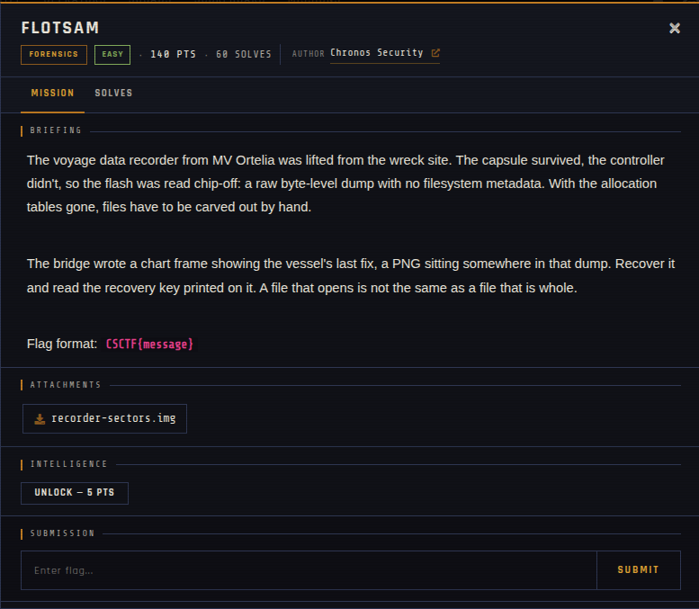

# Flotsam 🐾

| | |
|---|---|
| **Competition** | CSCTF 2026 |
| **Category** | Forensics |
| **Points** | 140 |
| **Author** | Chronos Security |
| **Difficulty** | Easy |
| **Solves** | 60 (at time of capture) |

## Description

> The voyage data recorder from MV Ortelia was lifted from the wreck site. The capsule survived, the controller didn't, so the flash was read chip-off: a raw byte-level dump with no filesystem metadata. With the allocation tables gone, files have to be carved out by hand.
>
> The bridge wrote a chart frame showing the vessel's last fix, a PNG sitting somewhere in that dump. Recover it and read the recovery key printed on it. A file that opens is not the same as a file that is whole.
>
> Flag format: `CSCTF{message}`

## Files

> ⚠️ Forensic material: open it only inside a VM and never run anything it contains.

| File | Notes |
|------|-------|
| `files/recorder-sectors.img` | Raw flash dump, 35,840 bytes |

## Screenshots

---
Source: CSCTF 2026 · Chronos Security
Archived by [StrayHound](https://strayhound.team) 🐾
