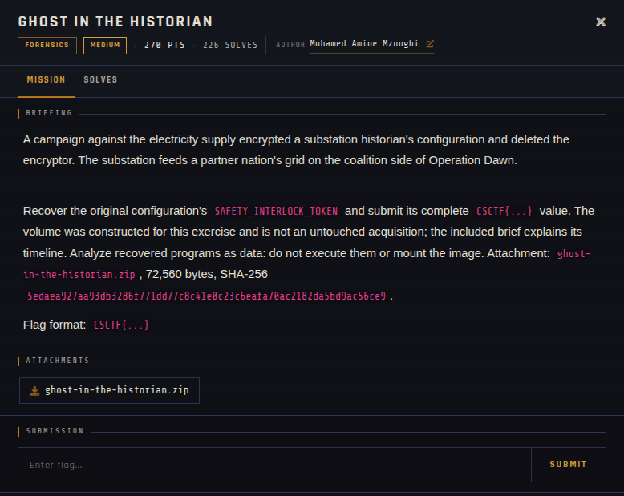

# Ghost in the Historian 🐾

| | |
|---|---|
| **Competition** | CSCTF 2026 |
| **Category** | Forensics |
| **Points** | 270 |
| **Author** | Mohamed Amine Mzoughi |
| **Difficulty** | Medium |
| **Solves** | 226 (at time of capture) |

## Description

> A campaign against the electricity supply encrypted a substation historian's configuration and deleted the encryptor. The substation feeds a partner nation's grid on the coalition side of Operation Dawn.
>
> Recover the original configuration's `SAFETY_INTERLOCK_TOKEN` and submit its complete `CSCTF{...}` value. The volume was constructed for this exercise and is not an untouched acquisition; the included brief explains its timeline. Analyze recovered programs as data: do not execute them or mount the image. Attachment: `ghost-in-the-historian.zip`, 72,560 bytes, SHA-256 `5edaea927aa93db3286f771dd77c8c41e0c23c6eafa70ac2182da5bd9ac56ce9`.
>
> Flag format: `CSCTF{...}`

## Files

> ⚠️ Forensic material: open it only inside a VM and never run anything it contains.

| File | Notes |
|------|-------|
| `files/ghost-in-the-historian.zip` | Challenge archive, 72,560 bytes |

## Screenshots

---
Source: CSCTF 2026 · Mohamed Amine Mzoughi
Archived by [StrayHound](https://strayhound.team) 🐾
