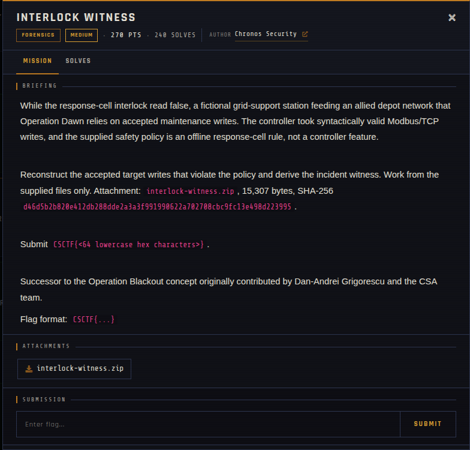

# Interlock Witness 🐾

| | |
|---|---|
| **Competition** | CSCTF 2026 |
| **Category** | Forensics |
| **Points** | 270 |
| **Author** | Chronos Security |
| **Difficulty** | Medium |
| **Solves** | 240 (at time of capture) |

## Description

> While the response-cell interlock read false, a fictional grid-support station feeding an allied depot network that Operation Dawn relies on accepted maintenance writes. The controller took syntactically valid Modbus/TCP writes, and the supplied safety policy is an offline response-cell rule, not a controller feature.
>
> Reconstruct the accepted target writes that violate the policy and derive the incident witness. Work from the supplied files only. Attachment: `interlock-witness.zip`, 15,307 bytes, SHA-256 `d46d5b2b820e412db288dde2a3a3f991990622a702708cbc9fc13e498d223995`.
>
> Submit `CSCTF{<64 lowercase hex characters>}`.
>
> Successor to the Operation Blackout concept originally contributed by Dan-Andrei Grigorescu and the CSA team.
>
> Flag format: `CSCTF{...}`

## Files

> ⚠️ Forensic material: open it only inside a VM and never run anything it contains.

| File | Notes |
|------|-------|
| `files/interlock-witness.zip` | Challenge archive, 15,307 bytes |

## Screenshots

---
Source: CSCTF 2026 · Chronos Security
Archived by [StrayHound](https://strayhound.team) 🐾
