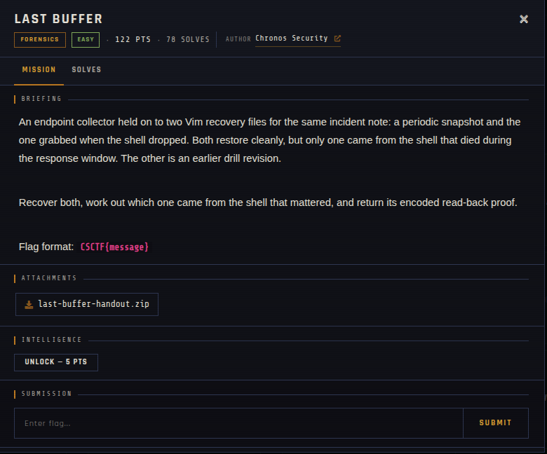

# Last Buffer 🐾

| | |
|---|---|
| **Competition** | CSCTF 2026 |
| **Category** | Forensics |
| **Points** | 120 |
| **Author** | Chronos Security |
| **Difficulty** | Easy |
| **Solves** | 78 (at time of capture) |

## Description

> An endpoint collector held on to two Vim recovery files for the same incident note: a periodic snapshot and the one grabbed when the shell dropped. Both restore cleanly, but only one came from the shell that died during the response window. The other is an earlier drill revision.
>
> Recover both, work out which one came from the shell that mattered, and return its encoded read-back proof.
>
> Flag format: `CSCTF{message}`

## Files

> ⚠️ Forensic material: open it only inside a VM and never run anything it contains.

| File | Notes |
|------|-------|
| `files/last-buffer-handout.zip` | Challenge archive, 3,270 bytes |

## Screenshots

---
Source: CSCTF 2026 · Chronos Security
Archived by [StrayHound](https://strayhound.team) 🐾
