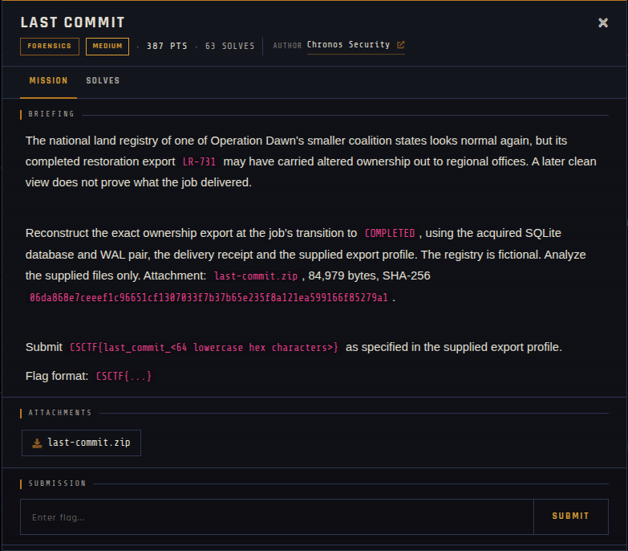

# Last Commit 🐾

| | |
|---|---|
| **Competition** | CSCTF 2026 |
| **Category** | Forensics |
| **Points** | 387 |
| **Author** | Chronos Security |
| **Difficulty** | Medium |
| **Solves** | 63 (at time of capture) |

## Description

> The national land registry of one of Operation Dawn's smaller coalition states looks normal again, but its completed restoration export `LR-731` may have carried altered ownership out to regional offices. A later clean view does not prove what the job delivered.
>
> Reconstruct the exact ownership export at the job's transition to `COMPLETED`, using the acquired SQLite database and WAL pair, the delivery receipt and the supplied export profile. The registry is fictional. Analyze the supplied files only. Attachment: `last-commit.zip`, 84,979 bytes, SHA-256 `06da868e7ceeef1c96651cf1307033f7b37b65e235f8a121ea599166f85279a1`.
>
> Submit `CSCTF{last_commit_<64 lowercase hex characters>}` as specified in the supplied export profile.
>
> Flag format: `CSCTF{...}`

## Files

> ⚠️ Forensic material: open it only inside a VM and never run anything it contains.

| File | Notes |
|------|-------|
| `files/last-commit.zip` | Challenge archive, 84,979 bytes |

## Screenshots

---
Source: CSCTF 2026 · Chronos Security
Archived by [StrayHound](https://strayhound.team) 🐾
