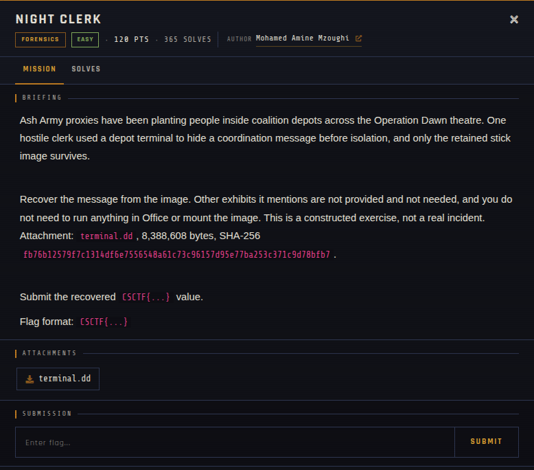

# Night Clerk 🐾

| | |
|---|---|
| **Competition** | CSCTF 2026 |
| **Category** | Forensics |
| **Points** | 120 |
| **Author** | Mohamed Amine Mzoughi |
| **Difficulty** | Easy |
| **Solves** | 365 (at time of capture) |

## Description

> Ash Army proxies have been planting people inside coalition depots across the Operation Dawn theatre. One hostile clerk used a depot terminal to hide a coordination message before isolation, and only the retained stick image survives.
>
> Recover the message from the image. Other exhibits it mentions are not provided and not needed, and you do not need to run anything in Office or mount the image. This is a constructed exercise, not a real incident. Attachment: `terminal.dd`, 8,388,608 bytes, SHA-256 `fb76b12579f7c1314df6e7556548a61c73c96157d95e77ba253c371c9d78bfb7`.
>
> Submit the recovered `CSCTF{...}` value.
>
> Flag format: `CSCTF{...}`

## Files

> ⚠️ Forensic material: open it only inside a VM and never run anything it contains.

| File | Notes |
|------|-------|
| `files/terminal.dd` | Raw disk image, 8,388,608 bytes |

## Screenshots

---
Source: CSCTF 2026 · Mohamed Amine Mzoughi
Archived by [StrayHound](https://strayhound.team) 🐾
