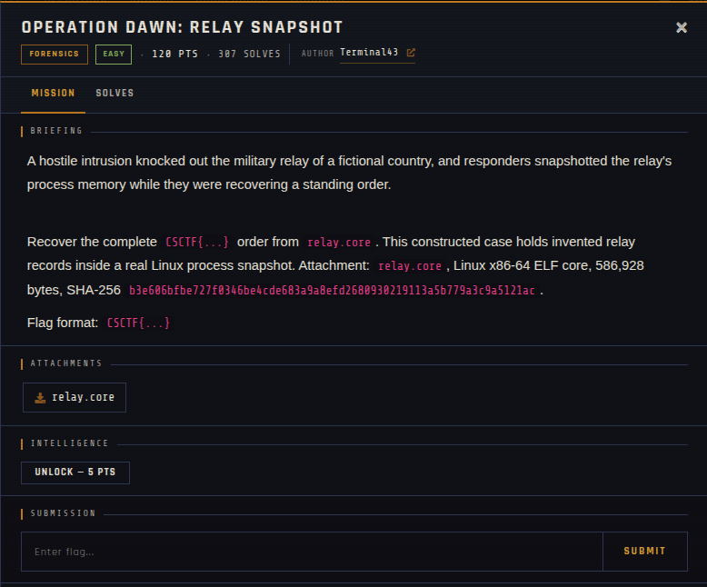

# Operation Dawn: Relay Snapshot 🐾

| | |
|---|---|
| **Competition** | CSCTF 2026 |
| **Category** | Forensics |
| **Points** | 120 |
| **Author** | Terminal43 |
| **Difficulty** | Easy |
| **Solves** | 307 (at time of capture) |

## Description

> A hostile intrusion knocked out the military relay of a fictional country, and responders snapshotted the relay's process memory while they were recovering a standing order.
>
> Recover the complete `CSCTF{...}` order from `relay.core`. This constructed case holds invented relay records inside a real Linux process snapshot. Attachment: `relay.core`, Linux x86-64 ELF core, 586,928 bytes, SHA-256 `b3e606bfbe727f0346be4cde683a9a8efd2680930219113a5b779a3c9a5121ac`.
>
> Flag format: `CSCTF{...}`

## Files

> ⚠️ Forensic material: open it only inside a VM and never run anything it contains.

| File | Notes |
|------|-------|
| `files/relay.core` | Linux x86-64 ELF core dump, 586,928 bytes |

## Screenshots

---
Source: CSCTF 2026 · Terminal43
Archived by [StrayHound](https://strayhound.team) 🐾
