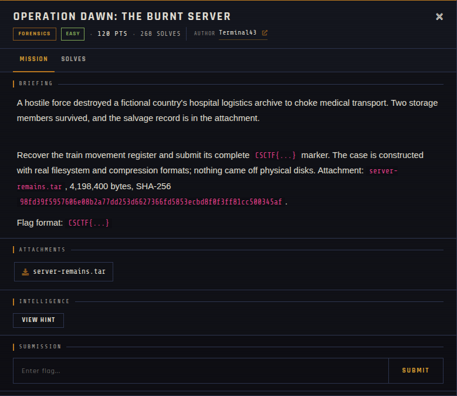
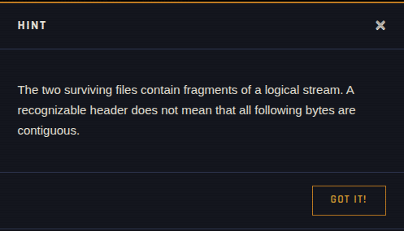

# Operation Dawn: The Burnt Server 🐾

| | |
|---|---|
| **Competition** | CSCTF 2026 |
| **Category** | Forensics |
| **Points** | 120 |
| **Author** | Terminal43 |
| **Difficulty** | Easy |
| **Solves** | 268 (at time of capture) |

## Description

> A hostile force destroyed a fictional country's hospital logistics archive to choke medical transport. Two storage members survived, and the salvage record is in the attachment.
>
> Recover the train movement register and submit its complete `CSCTF{...}` marker. The case is constructed with real filesystem and compression formats; nothing came off physical disks. Attachment: `server-remains.tar`, 4,198,400 bytes, SHA-256 `98fd39f5957606e08b2a77dd253d6627366fd5853ecbd8f0f3ff81cc500345af`.
>
> Flag format: `CSCTF{...}`

## Files

> ⚠️ Forensic material: open it only inside a VM and never run anything it contains.

| File | Notes |
|------|-------|
| `files/server-remains.tar` | Challenge archive, 4,198,400 bytes |

## Screenshots

## Solve

⚠️ Spoilers: hint and notes

- Platform hint (unlocked): The two surviving files contain fragments of a logical stream. A recognizable header does not mean that all following bytes are contiguous.
  

---
Source: CSCTF 2026 · Terminal43
Archived by [StrayHound](https://strayhound.team) 🐾
