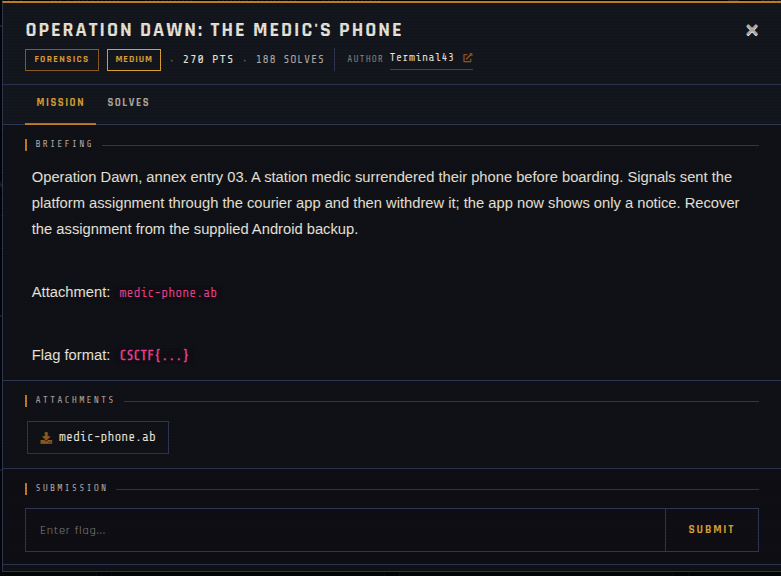

# Operation Dawn: The Medic's Phone 🐾

| | |
|---|---|
| **Competition** | CSCTF 2026 |
| **Category** | Forensics |
| **Points** | 270 |
| **Author** | Terminal43 |
| **Difficulty** | Medium |
| **Solves** | 188 (at time of capture) |

## Description

> Operation Dawn, annex entry 03. A station medic surrendered their phone before boarding. Signals sent the platform assignment through the courier app and then withdrew it; the app now shows only a notice. Recover the assignment from the supplied Android backup.
>
> Attachment: `medic-phone.ab`
>
> Flag format: `CSCTF{...}`

## Files

> ⚠️ Forensic material: open it only inside a VM and never run anything it contains.

| File | Notes |
|------|-------|
| `files/medic-phone.ab` | Android backup, 2,809 bytes |

## Screenshots

---
Source: CSCTF 2026 · Terminal43
Archived by [StrayHound](https://strayhound.team) 🐾
