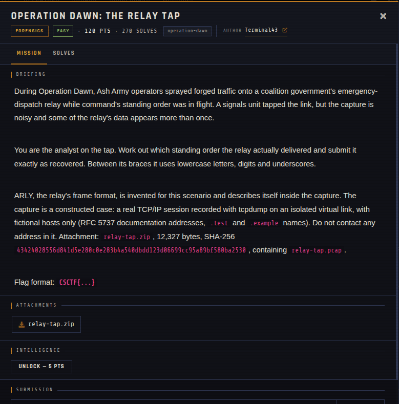

# Operation Dawn: The Relay Tap 🐾

| | |
|---|---|
| **Competition** | CSCTF 2026 |
| **Category** | Forensics |
| **Points** | 120 |
| **Author** | Terminal43 |
| **Difficulty** | Easy |
| **Solves** | 270 (at time of capture) |

## Description

> During Operation Dawn, Ash Army operators sprayed forged traffic onto a coalition government's emergency-dispatch relay while command's standing order was in flight. A signals unit tapped the link, but the capture is noisy and some of the relay's data appears more than once.
>
> You are the analyst on the tap. Work out which standing order the relay actually delivered and submit it exactly as recovered. Between its braces it uses lowercase letters, digits and underscores.
>
> ARLY, the relay's frame format, is invented for this scenario and describes itself inside the capture. The capture is a constructed case: a real TCP/IP session recorded with tcpdump on an isolated virtual link, with fictional hosts only (RFC 5737 documentation addresses, `.test` and `.example` names). Do not contact any address in it. Attachment: `relay-tap.zip`, 12,327 bytes, SHA-256 `43424028556d841d5e280c0e283b4a540dbdd123d06699cc95a89bf580ba2530`, containing `relay-tap.pcap`.
>
> Flag format: `CSCTF{...}`

## Files

> ⚠️ Forensic material: open it only inside a VM and never run anything it contains.

| File | Notes |
|------|-------|
| `files/relay-tap.zip` | Challenge archive, contains `relay-tap.pcap`, 12,327 bytes |

## Screenshots

---
Source: CSCTF 2026 · Terminal43
Archived by [StrayHound](https://strayhound.team) 🐾
