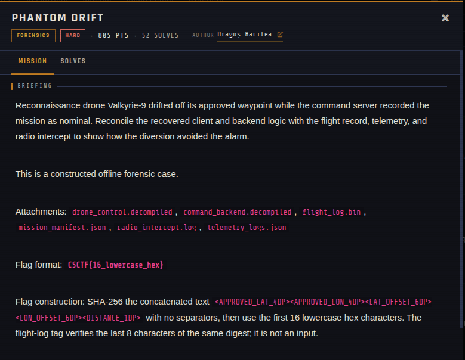
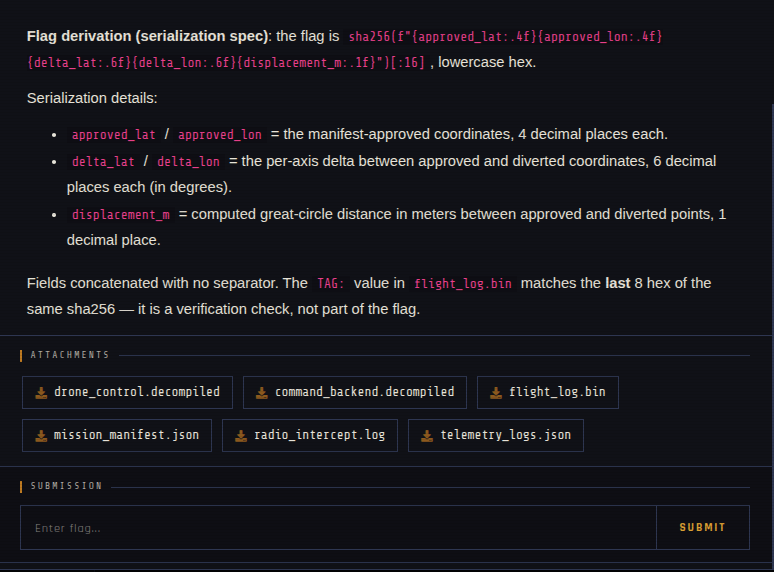

# Phantom Drift 🐾

| | |
|---|---|
| **Competition** | CSCTF 2026 |
| **Category** | Forensics |
| **Points** | 560 |
| **Author** | Dragoș Bacitea |
| **Difficulty** | Hard |
| **Solves** | 52 (at time of capture) |

## Description

> Reconnaissance drone Valkyrie-9 drifted off its approved waypoint while the command server recorded the mission as nominal. Reconcile the recovered client and backend logic with the flight record, telemetry, and radio intercept to show how the diversion avoided the alarm.
>
> This is a constructed offline forensic case.
>
> Attachments: drone_control.decompiled, command_backend.decompiled, flight_log.bin, mission_manifest.json, radio_intercept.log, telemetry_logs.json
>
> Flag format: CSCTF{16_lowercase_hex}
>
> Flag construction: SHA-256 the concatenated text <APPROVED_LAT_4DP><APPROVED_LON_4DP><LAT_OFFSET_6DP><LON_OFFSET_6DP><DISTANCE_1DP> with no separators, then use the first 16 lowercase hex characters. The flight-log tag verifies the last 8 characters of the same digest; it is not an input.
>
> Flag derivation (serialization spec): the flag is sha256(f"{approved_lat:.4f}{approved_lon:.4f}{delta_lat:.6f}{delta_lon:.6f}{displacement_m:.1f}")[:16], lowercase hex.
>
> Serialization details:
>
> approved_lat / approved_lon = the manifest-approved coordinates, 4 decimal places each.
> delta_lat / delta_lon = the per-axis delta between approved and diverted coordinates, 6 decimal places each (in degrees).
> displacement_m = computed great-circle distance in meters between approved and diverted points, 1 decimal place.
> Fields concatenated with no separator. The TAG: value in flight_log.bin matches the last 8 hex of the same sha256 — it is a verification check, not part of the flag.

## Files

> ⚠️ Forensic material: open it only inside a VM and never run anything it contains.

| File | Notes |
|------|-------|
| `files/drone_control.decompiled` | Recovered client logic (decompiled), 10,045 bytes |
| `files/command_backend.decompiled` | Recovered backend logic (decompiled), 5,917 bytes |
| `files/flight_log.bin` | Flight record, 36 bytes |
| `files/mission_manifest.json` | Mission manifest, 1,060 bytes |
| `files/radio_intercept.log` | Radio intercept, 1,981 bytes |
| `files/telemetry_logs.json` | Telemetry, 13,427 bytes |

## Screenshots

---
Source: CSCTF 2026 · Dragoș Bacitea
Archived by [StrayHound](https://strayhound.team) 🐾
