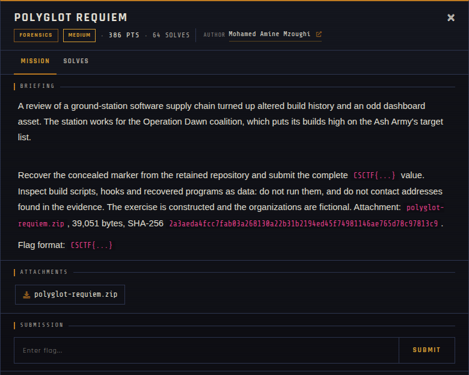

# Polyglot Requiem 🐾

| | |
|---|---|
| **Competition** | CSCTF 2026 |
| **Category** | Forensics |
| **Points** | 270 |
| **Author** | Mohamed Amine Mzoughi |
| **Difficulty** | Medium |
| **Solves** | 64 (at time of capture) |

## Description

> A review of a ground-station software supply chain turned up altered build history and an odd dashboard asset. The station works for the Operation Dawn coalition, which puts its builds high on the Ash Army's target list.
>
> Recover the concealed marker from the retained repository and submit the complete `CSCTF{...}` value. Inspect build scripts, hooks and recovered programs as data: do not run them, and do not contact addresses found in the evidence. The exercise is constructed and the organizations are fictional. Attachment: `polyglot-requiem.zip`, 39,051 bytes, SHA-256 `2a3aeda4fcc7fab03a268130a22b31b2194ed45f74981146ae765d78c97813c9`.
>
> Flag format: `CSCTF{...}`

## Files

> ⚠️ Forensic material: open it only inside a VM and never run anything it contains.

| File | Notes |
|------|-------|
| `files/polyglot-requiem.zip` | Challenge archive, 39,051 bytes |

## Screenshots

---
Source: CSCTF 2026 · Mohamed Amine Mzoughi
Archived by [StrayHound](https://strayhound.team) 🐾
