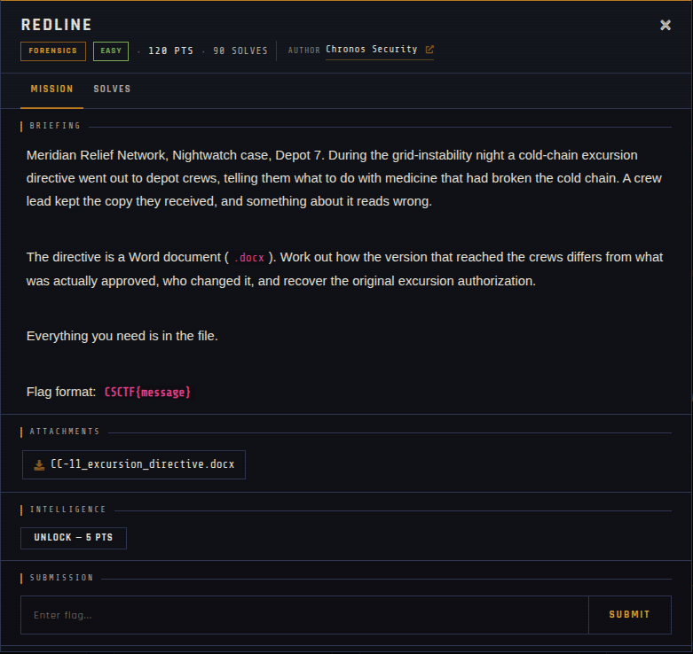

# Redline 🐾

| | |
|---|---|
| **Competition** | CSCTF 2026 |
| **Category** | Forensics |
| **Points** | 120 |
| **Author** | Chronos Security |
| **Difficulty** | Easy |
| **Solves** | 90 (at time of capture) |

## Description

> Meridian Relief Network, Nightwatch case, Depot 7. During the grid-instability night a cold-chain excursion directive went out to depot crews, telling them what to do with medicine that had broken the cold chain. A crew lead kept the copy they received, and something about it reads wrong.
>
> The directive is a Word document (`.docx`). Work out how the version that reached the crews differs from what was actually approved, who changed it, and recover the original excursion authorization.
>
> Everything you need is in the file.
>
> Flag format: `CSCTF{message}`

## Files

> ⚠️ Forensic material: open it only inside a VM and never run anything it contains.

| File | Notes |
|------|-------|
| `files/CC-11_excursion_directive.docx` | Word document, 3,817 bytes |

## Screenshots

---
Source: CSCTF 2026 · Chronos Security
Archived by [StrayHound](https://strayhound.team) 🐾
