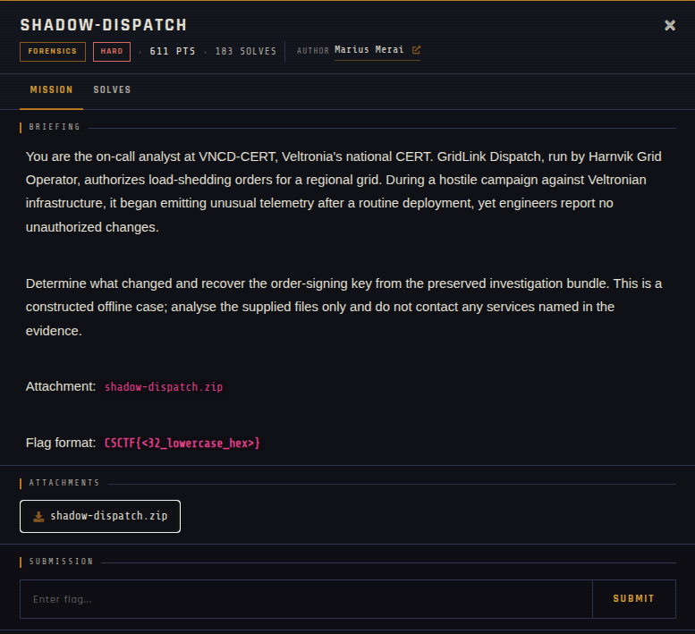

# Shadow-Dispatch 🐾

| | |
|---|---|
| **Competition** | CSCTF 2026 |
| **Category** | Forensics |
| **Points** | 611 |
| **Author** | Marius Merai |
| **Difficulty** | Hard |
| **Solves** | 103 (at time of capture) |

## Description

> You are the on-call analyst at VNCD-CERT, Veltronia's national CERT. GridLink Dispatch, run by Harnvik Grid Operator, authorizes load-shedding orders for a regional grid. During a hostile campaign against Veltronian infrastructure, it began emitting unusual telemetry after a routine deployment, yet engineers report no unauthorized changes.
>
> Determine what changed and recover the order-signing key from the preserved investigation bundle. This is a constructed offline case; analyse the supplied files only and do not contact any services named in the evidence.
>
> Attachment: `shadow-dispatch.zip`
>
> Flag format: `CSCTF{<32_lowercase_hex>}`

## Files

> ⚠️ Forensic material: open it only inside a VM and never run anything it contains.

| File | Notes |
|------|-------|
| `files/shadow-dispatch.zip` | Challenge archive, 5,348,428 bytes |

## Screenshots

---
Source: CSCTF 2026 · Marius Merai
Archived by [StrayHound](https://strayhound.team) 🐾
