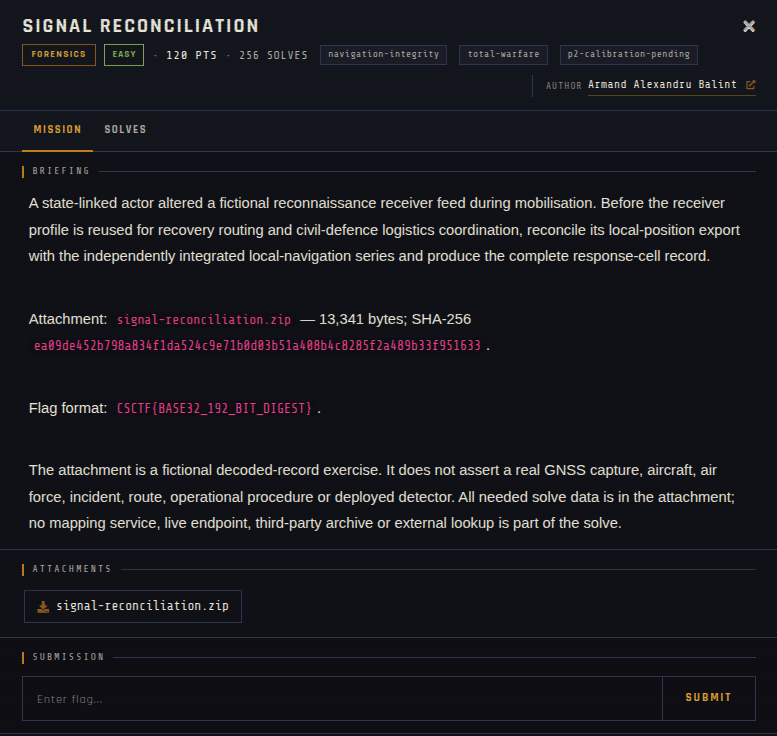

# Signal Reconciliation 🐾

| | |
|---|---|
| **Competition** | CSCTF 2026 |
| **Category** | Forensics |
| **Points** | 120 |
| **Author** | Armand Alexandru Balint |
| **Difficulty** | Easy |
| **Solves** | 256 (at time of capture) |

## Description

> A state-linked actor altered a fictional reconnaissance receiver feed during mobilisation. Before the receiver profile is reused for recovery routing and civil-defence logistics coordination, reconcile its local-position export with the independently integrated local-navigation series and produce the complete response-cell record.
>
> Attachment: `signal-reconciliation.zip` — 13,341 bytes; SHA-256 `ea09de452b798a834f1da524c9e71b0d03b51a408b4c8285f2a489b33f951633`.
>
> Flag format: `CSCTF{BASE32_192_BIT_DIGEST}`.
>
> The attachment is a fictional decoded-record exercise. It does not assert a real GNSS capture, aircraft, air force, incident, route, operational procedure or deployed detector. All needed solve data is in the attachment; no mapping service, live endpoint, third-party archive or external lookup is part of the solve.

## Files

> ⚠️ Forensic material: open it only inside a VM and never run anything it contains.

| File | Notes |
|------|-------|
| `files/signal-reconciliation.zip` | Challenge archive, 13,341 bytes |

## Screenshots

---
Source: CSCTF 2026 · Armand Alexandru Balint
Archived by [StrayHound](https://strayhound.team) 🐾
