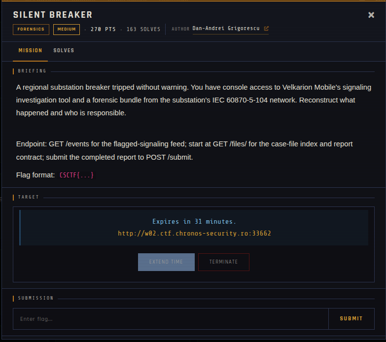
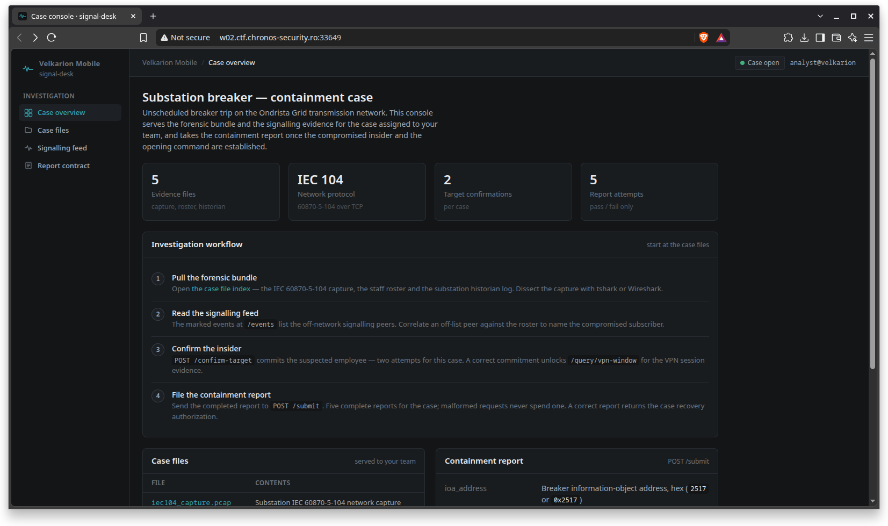
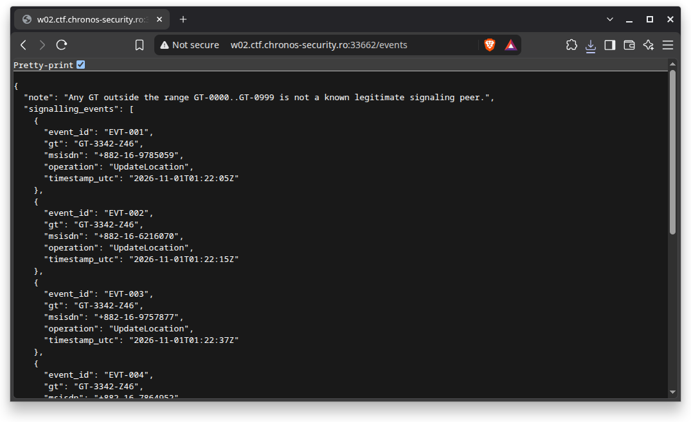

# Silent Breaker 🐾

| | |
|---|---|
| **Competition** | CSCTF 2026 |
| **Category** | Forensics |
| **Points** | 270 |
| **Author** | Dan-Andrei Grigorescu |
| **Difficulty** | Medium |
| **Solves** | 163 (at time of capture) |

## Description

> A regional substation breaker tripped without warning. You have console access to Velkarion Mobile's signaling investigation tool and a forensic bundle from the substation's IEC 60870-5-104 network. Reconstruct what happened and who is responsible.
>
> Endpoint: GET /events for the flagged-signaling feed; start at GET /files/ for the case-file index and report contract; submit the completed report to POST /submit.
>
> Flag format: `CSCTF{...}`

## Files

> ⚠️ Forensic material: open it only inside a VM and never run anything it contains.

| File | Notes |
|------|-------|
| `files/README.md` | Organizer's case brief: endpoints, report contract and submit fields, 2,858 bytes |
| `files/description.md` | Organizer's shorter description text, 428 bytes |
| `files/roster.json` | Staff roster, 1,441 bytes |
| `files/iec104_capture.pcap` | IEC 60870-5-104 network capture, 10,518 bytes |
| `files/hmi_monitoring.log` | Substation historian breaker-current log, 4,400 bytes |
| `files/events.json` | Saved copy of the `/events` signalling feed, 1,094 bytes |

## Remote service

Offline since the event ended. The challenge ran as a per-team live instance (`signal-desk`); each launch was its own case with fresh evidence. The saved evidence files are in `files/`, and the endpoints and report contract are described in `files/README.md`.

## Screenshots

---
Source: CSCTF 2026 · Dan-Andrei Grigorescu
Archived by [StrayHound](https://strayhound.team) 🐾
