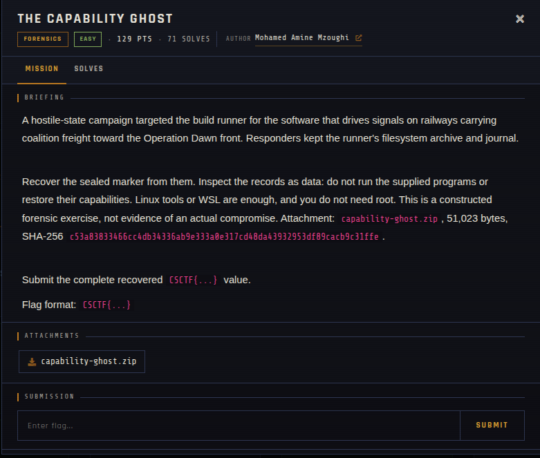

# The Capability Ghost 🐾

| | |
|---|---|
| **Competition** | CSCTF 2026 |
| **Category** | Forensics |
| **Points** | 129 |
| **Author** | Mohamed Amine Mzoughi |
| **Difficulty** | Easy |
| **Solves** | 71 (at time of capture) |

## Description

> A hostile-state campaign targeted the build runner for the software that drives signals on railways carrying coalition freight toward the Operation Dawn front. Responders kept the runner's filesystem archive and journal.
>
> Recover the sealed marker from them. Inspect the records as data: do not run the supplied programs or restore their capabilities. Linux tools or WSL are enough, and you do not need root. This is a constructed forensic exercise, not evidence of an actual compromise. Attachment: `capability-ghost.zip`, 51,023 bytes, SHA-256 `c53a83833466cc4db34336ab9e333a0e317cd48da43932953df89cacb9c31ffe`.
>
> Submit the complete recovered `CSCTF{...}` value.
>
> Flag format: `CSCTF{...}`

## Files

> ⚠️ Forensic material: open it only inside a VM and never run anything it contains.

| File | Notes |
|------|-------|
| `files/capability-ghost.zip` | Challenge archive, 51,023 bytes |

## Screenshots

---
Source: CSCTF 2026 · Mohamed Amine Mzoughi
Archived by [StrayHound](https://strayhound.team) 🐾
