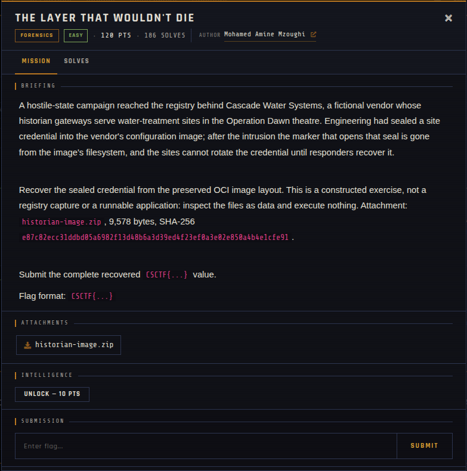

# The Layer That Wouldn't Die 🐾

| | |
|---|---|
| **Competition** | CSCTF 2026 |
| **Category** | Forensics |
| **Points** | 120 |
| **Author** | Mohamed Amine Mzoughi |
| **Difficulty** | Easy |
| **Solves** | 186 (at time of capture) |

## Description

> A hostile-state campaign reached the registry behind Cascade Water Systems, a fictional vendor whose historian gateways serve water-treatment sites in the Operation Dawn theatre. Engineering had sealed a site credential into the vendor's configuration image; after the intrusion the marker that opens that seal is gone from the image's filesystem, and the sites cannot rotate the credential until responders recover it.
>
> Recover the sealed credential from the preserved OCI image layout. This is a constructed exercise, not a registry capture or a runnable application: inspect the files as data and execute nothing. Attachment: `historian-image.zip`, 9,578 bytes, SHA-256 `e87c82ecc31ddbd05a6982f13d48b6a3d39ed4f23ef0a3e02e850a4b4e1cfe91`.
>
> Submit the complete recovered `CSCTF{...}` value.
>
> Flag format: `CSCTF{...}`

## Files

> ⚠️ Forensic material: open it only inside a VM and never run anything it contains.

| File | Notes |
|------|-------|
| `files/historian-image.zip` | Challenge archive, 9,578 bytes |

## Screenshots

---
Source: CSCTF 2026 · Mohamed Amine Mzoughi
Archived by [StrayHound](https://strayhound.team) 🐾
