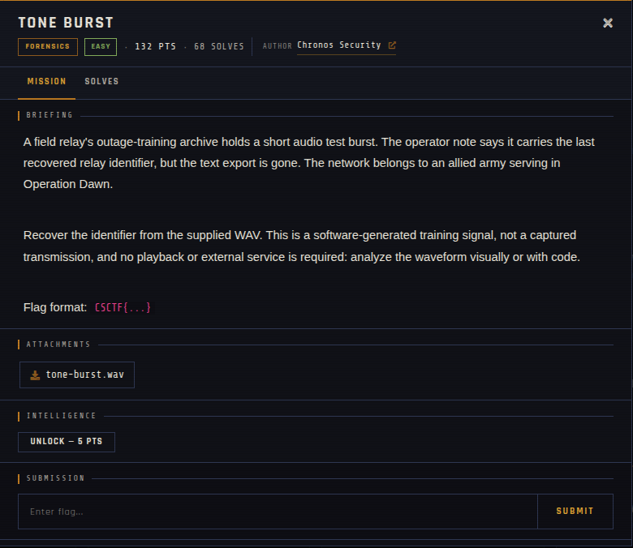

# Tone Burst 🐾

| | |
|---|---|
| **Competition** | CSCTF 2026 |
| **Category** | Forensics |
| **Points** | 120 |
| **Author** | Chronos Security |
| **Difficulty** | Easy |
| **Solves** | 68 (at time of capture) |

## Description

> A field relay's outage-training archive holds a short audio test burst. The operator note says it carries the last recovered relay identifier, but the text export is gone. The network belongs to an allied army serving in Operation Dawn.
>
> Recover the identifier from the supplied WAV. This is a software-generated training signal, not a captured transmission, and no playback or external service is required: analyze the waveform visually or with code.
>
> Flag format: `CSCTF{...}`

## Files

> ⚠️ Forensic material: open it only inside a VM and never run anything it contains.

| File | Notes |
|------|-------|
| `files/tone-burst.wav` | WAV audio, 147,244 bytes |

## Screenshots

---
Source: CSCTF 2026 · Chronos Security
Archived by [StrayHound](https://strayhound.team) 🐾
