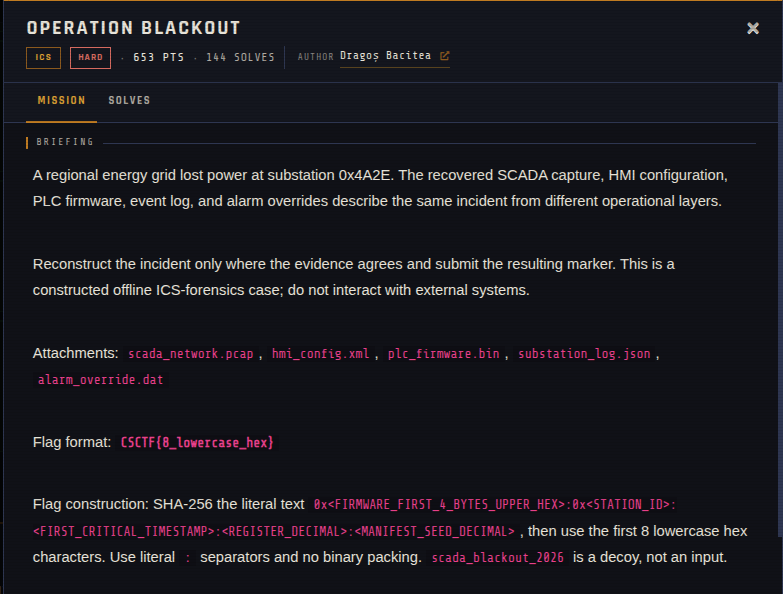
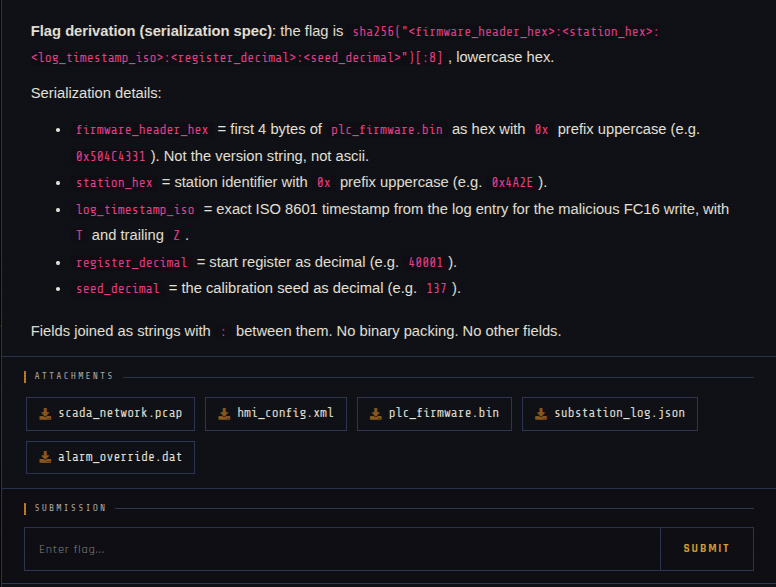

# Operation Blackout 🐾

| | |
|---|---|
| **Competition** | CSCTF 2026 |
| **Category** | ICS |
| **Points** | 540 |
| **Author** | Dragoș Bacitea |
| **Difficulty** | Hard |
| **Solves** | 144 (at time of capture) |

## Description

> A regional energy grid lost power at substation 0x4A2E. The recovered SCADA capture, HMI configuration, PLC firmware, event log, and alarm overrides describe the same incident from different operational layers.
>
> Reconstruct the incident only where the evidence agrees and submit the resulting marker. This is a constructed offline ICS-forensics case; do not interact with external systems.
>
> Attachments: `scada_network.pcap`, `hmi_config.xml`, `plc_firmware.bin`, `substation_log.json`, `alarm_override.dat`
>
> Flag format: `CSCTF{8_lowercase_hex}`
>
> Flag construction: SHA-256 the literal text `0x<FIRMWARE_FIRST_4_BYTES_UPPER_HEX>:0x<STATION_ID>:<FIRST_CRITICAL_TIMESTAMP>:<REGISTER_DECIMAL>:<MANIFEST_SEED_DECIMAL>`, then use the first 8 lowercase hex characters. Use literal `:` separators and no binary packing. `scada_blackout_2026` is a decoy, not an input.
>
> **Flag derivation (serialization spec)**: the flag is `sha256("<firmware_header_hex>:<station_hex>:<log_timestamp_iso>:<register_decimal>:<seed_decimal>")[:8]`, lowercase hex.
>
> Serialization details:
>
> - `firmware_header_hex` = first 4 bytes of `plc_firmware.bin` as hex with `0x` prefix uppercase (e.g. `0x504C4331`). Not the version string, not ascii.
> - `station_hex` = station identifier with `0x` prefix uppercase (e.g. `0x4A2E`).
> - `log_timestamp_iso` = exact ISO 8601 timestamp from the log entry for the malicious FC16 write, with `T` and trailing `Z`.
> - `register_decimal` = start register as decimal (e.g. `40001`).
> - `seed_decimal` = the calibration seed as decimal (e.g. `137`).
>
> Fields joined as strings with `:` between them. No binary packing. No other fields.

## Files

> ⚠️ Contains firmware and a network capture: open them only inside a VM and never execute anything.

| File | Notes |
|------|-------|
| `files/scada_network.pcap` | SCADA network capture, 3,688 bytes |
| `files/hmi_config.xml` | HMI configuration, 1,093 bytes |
| `files/plc_firmware.bin` | PLC firmware, 1,024 bytes |
| `files/substation_log.json` | Substation event log, 1,689 bytes |
| `files/alarm_override.dat` | Alarm overrides, 136 bytes |

## Screenshots

---
Source: CSCTF 2026 · Dragoș Bacitea
Archived by [StrayHound](https://strayhound.team) 🐾
