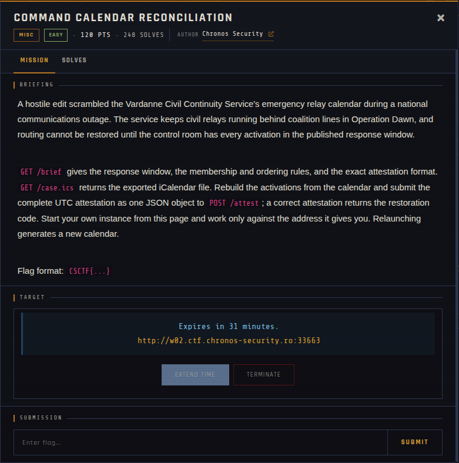
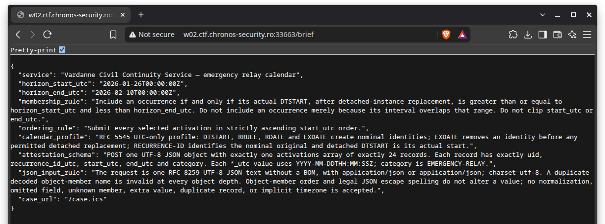
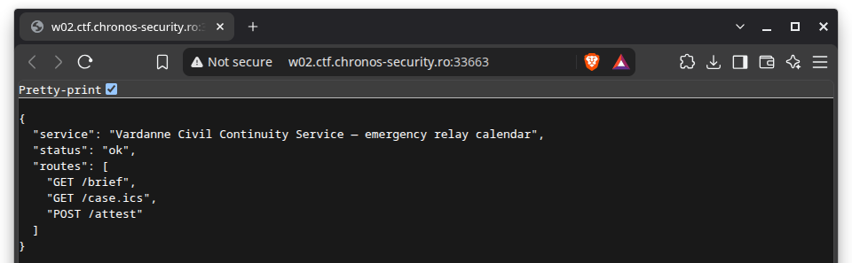

# Command Calendar Reconciliation 🐾

| | |
|---|---|
| **Competition** | CSCTF 2026 |
| **Category** | Misc |
| **Points** | 120 |
| **Author** | Chronos Security |
| **Difficulty** | Easy |
| **Solves** | 248 (at time of capture) |

## Description

> A hostile edit scrambled the Vardanne Civil Continuity Service's emergency relay calendar during a national communications outage. The service keeps civil relays running behind coalition lines in Operation Dawn, and routing cannot be restored until the control room has every activation in the published response window.
>
> `GET /brief` gives the response window, the membership and ordering rules, and the exact attestation format. `GET /case.ics` returns the exported iCalendar file. Rebuild the activations from the calendar and submit the complete UTC attestation as one JSON object to `POST /attest`; a correct attestation returns the restoration code. Start your own instance from this page and work only against the address it gives you. Relaunching generates a new calendar.
>
> Flag format: `CSCTF{...}`

## Files

| File | Notes |
|------|-------|
| `files/case.ics` | Exported iCalendar file (`GET /case.ics`), 1,362 bytes |
| `files/brief.txt` | Saved `GET /brief` response, 1,504 bytes |
| `files/site.json` | Saved index response (route list), 148 bytes |

## Remote service

Offline since the event ended. The challenge ran as a per-team instance with routes `GET /brief`, `GET /case.ics` and `POST /attest`; each relaunch generated a new calendar. The saved files in `files/` come from one instance, and the `/brief` screenshot comes from another, so the dates differ.

## Screenshots

## Solve

⚠️ Spoilers: solve files

- Attestation submitted to `POST /attest`: [`solve/attest.json`](solve/attest.json)

---
Source: CSCTF 2026 · Chronos Security
Archived by [StrayHound](https://strayhound.team) 🐾
