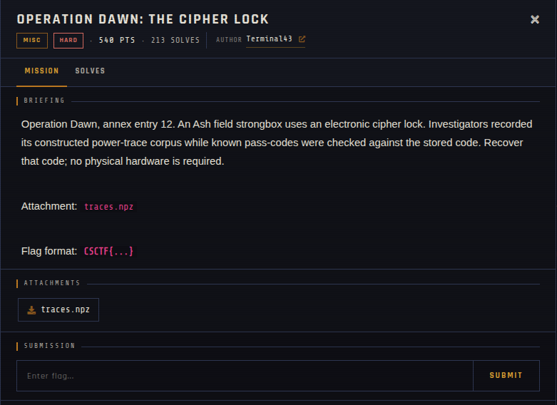

# Operation Dawn: The Cipher Lock 🐾

| | |
|---|---|
| **Competition** | CSCTF 2026 |
| **Category** | Misc |
| **Points** | 540 |
| **Author** | Terminal43 |
| **Difficulty** | Hard |
| **Solves** | 213 (at time of capture) |

## Description

> Operation Dawn, annex entry 12. An Ash field strongbox uses an electronic cipher lock. Investigators recorded its constructed power-trace corpus while known pass-codes were checked against the stored code. Recover that code; no physical hardware is required.
>
> Attachment: `traces.npz`
>
> Flag format: `CSCTF{...}`

## Files

> Load with `numpy.load(..., allow_pickle=False)`; never load untrusted `.npz` files with pickle enabled.

| File | Notes |
|------|-------|
| `files/traces.npz` | NumPy archive of power traces, 593,514 bytes |

## Screenshots

---
Source: CSCTF 2026 · Terminal43
Archived by [StrayHound](https://strayhound.team) 🐾
