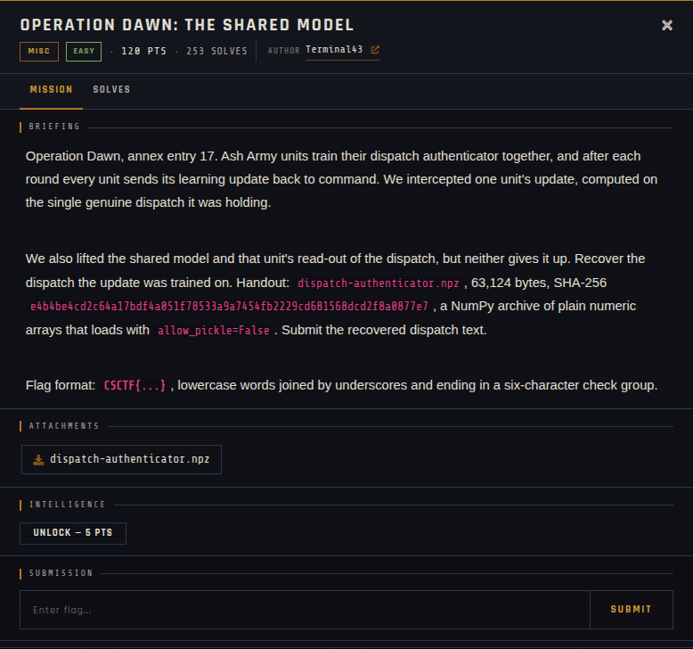

# Operation Dawn: The Shared Model 🐾

| | |
|---|---|
| **Competition** | CSCTF 2026 |
| **Category** | Misc |
| **Points** | 120 |
| **Author** | Terminal43 |
| **Difficulty** | Easy |
| **Solves** | 253 (at time of capture) |

## Description

> Operation Dawn, annex entry 17. Ash Army units train their dispatch authenticator together, and after each round every unit sends its learning update back to command. We intercepted one unit's update, computed on the single genuine dispatch it was holding.
>
> We also lifted the shared model and that unit's read-out of the dispatch, but neither gives it up. Recover the dispatch the update was trained on. Handout: `dispatch-authenticator.npz`, 63,124 bytes, SHA-256 `e4b4be4cd2c64a17bdf4a051f78533a9a7454fb2229cd681568dcd2f8a0877e7`, a NumPy archive of plain numeric arrays that loads with `allow_pickle=False`. Submit the recovered dispatch text.
>
> Flag format: `CSCTF{...}`, lowercase words joined by underscores and ending in a six-character check group.

## Files

| File | Notes |
|------|-------|
| `files/dispatch-authenticator.npz` | NumPy archive, 63,124 bytes |

## Screenshots

---
Source: CSCTF 2026 · Terminal43
Archived by [StrayHound](https://strayhound.team) 🐾
