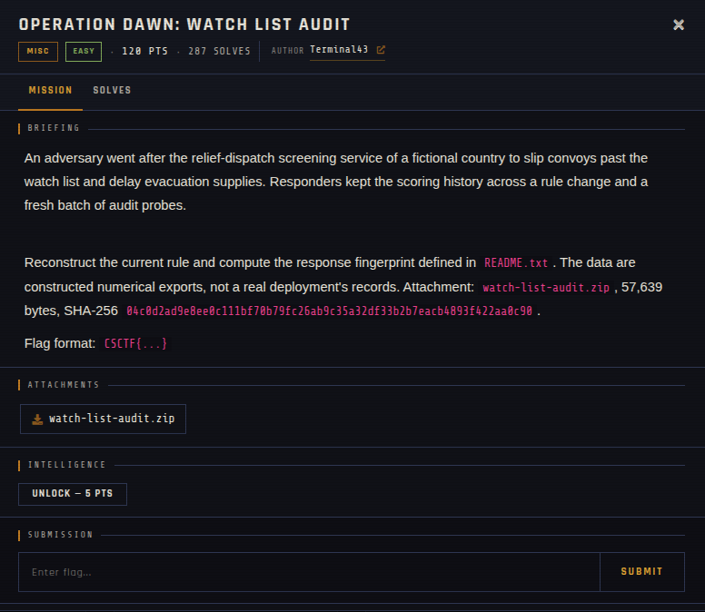

# Operation Dawn: Watch List Audit 🐾

| | |
|---|---|
| **Competition** | CSCTF 2026 |
| **Category** | Misc |
| **Points** | 120 |
| **Author** | Terminal43 |
| **Difficulty** | Easy |
| **Solves** | 287 (at time of capture) |

## Description

> An adversary went after the relief-dispatch screening service of a fictional country to slip convoys past the watch list and delay evacuation supplies. Responders kept the scoring history across a rule change and a fresh batch of audit probes.
>
> Reconstruct the current rule and compute the response fingerprint defined in `README.txt`. The data are constructed numerical exports, not a real deployment's records. Attachment: `watch-list-audit.zip`, 57,639 bytes, SHA-256 `04c0d2ad9e8ee0c111bf70b79fc26ab9c35a32df33b2b7eacb4893f422aa0c90`.
>
> Flag format: `CSCTF{...}`

## Files

| File | Notes |
|------|-------|
| `files/watch-list-audit.zip` | Challenge archive, 57,639 bytes |

## Screenshots

---
Source: CSCTF 2026 · Terminal43
Archived by [StrayHound](https://strayhound.team) 🐾
