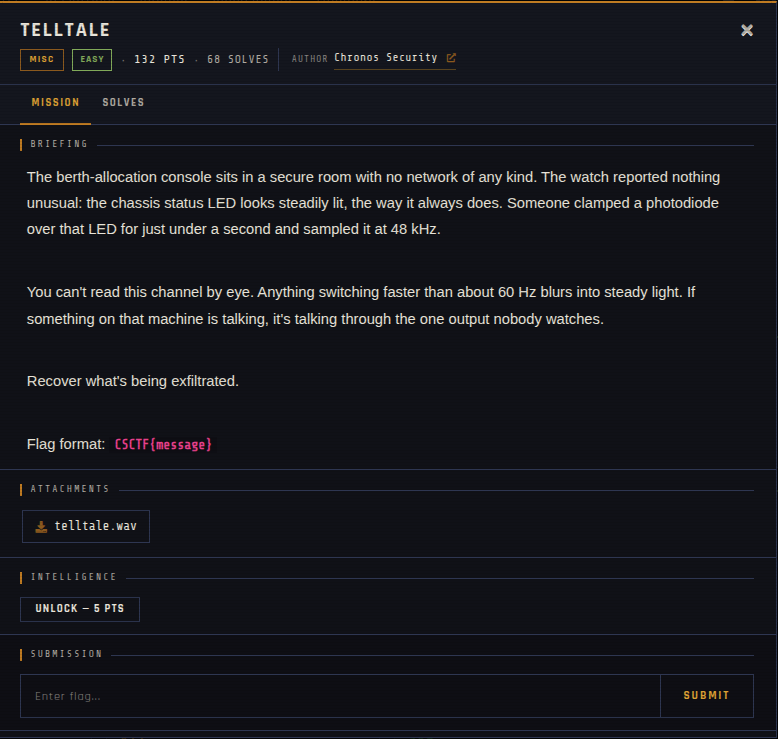

# Telltale 🐾

| | |
|---|---|
| **Competition** | CSCTF 2026 |
| **Category** | Misc |
| **Points** | 120 |
| **Author** | Chronos Security |
| **Difficulty** | Easy |
| **Solves** | 68 (at time of capture) |

## Description

> The berth-allocation console sits in a secure room with no network of any kind. The watch reported nothing unusual: the chassis status LED looks steadily lit, the way it always does. Someone clamped a photodiode over that LED for just under a second and sampled it at 48 kHz.
>
> You can't read this channel by eye. Anything switching faster than about 60 Hz blurs into steady light. If something on that machine is talking, it's talking through the one output nobody watches.
>
> Recover what's being exfiltrated.
>
> Flag format: `CSCTF{message}`

## Files

| File | Notes |
|------|-------|
| `files/telltale.wav` | WAV recording of the LED photodiode signal, 93,356 bytes |

## Screenshots

---
Source: CSCTF 2026 · Chronos Security
Archived by [StrayHound](https://strayhound.team) 🐾
