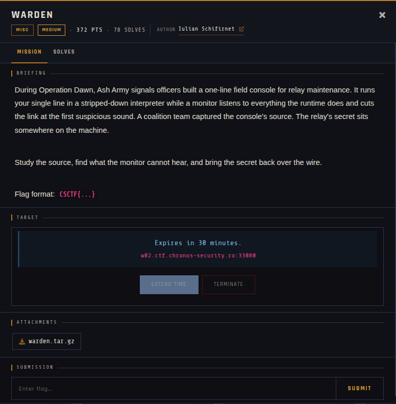
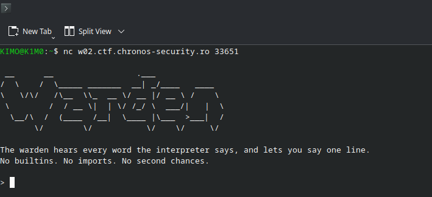

# warden 🐾

| | |
|---|---|
| **Competition** | CSCTF 2026 |
| **Category** | Misc |
| **Points** | 282 |
| **Author** | Iulian Schifirnet |
| **Difficulty** | Medium |
| **Solves** | 78 (at time of capture) |

## Description

> During Operation Dawn, Ash Army signals officers built a one-line field console for relay maintenance. It runs your single line in a stripped-down interpreter while a monitor listens to everything the runtime does and cuts the link at the first suspicious sound. A coalition team captured the console's source. The relay's secret sits somewhere on the machine.
>
> Study the source, find what the monitor cannot hear, and bring the secret back over the wire.
>
> Flag format: `CSCTF{...}`

## Files

| File | Notes |
|------|-------|
| `files/warden.tar.gz` | Captured console source (contains `jail.py`), 1,547 bytes |

## Remote service

Offline since the event ended. The challenge ran as a per-team instance reached with `nc`. Only the captured source is available, and it is in `files/warden.tar.gz`.

## Screenshots

---
Source: CSCTF 2026 · Iulian Schifirnet
Archived by [StrayHound](https://strayhound.team) 🐾
