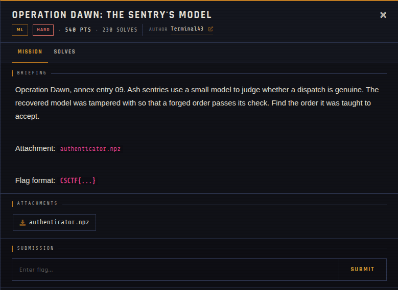

# Operation Dawn: The Sentry's Model 🐾

| | |
|---|---|
| **Competition** | CSCTF 2026 |
| **Category** | ML |
| **Points** | 540 |
| **Author** | Terminal43 |
| **Difficulty** | Hard |
| **Solves** | 230 (at time of capture) |

## Description

> Operation Dawn, annex entry 09. Ash sentries use a small model to judge whether a dispatch is genuine. The recovered model was tampered with so that a forged order passes its check. Find the order it was taught to accept.
>
> Attachment: `authenticator.npz`
>
> Flag format: `CSCTF{...}`

## Files

> Load with `numpy.load(..., allow_pickle=False)`; never load untrusted `.npz` files with pickle enabled.

| File | Notes |
|------|-------|
| `files/authenticator.npz` | NumPy archive of model weights, 152,270 bytes |

## Screenshots

---
Source: CSCTF 2026 · Terminal43
Archived by [StrayHound](https://strayhound.team) 🐾
