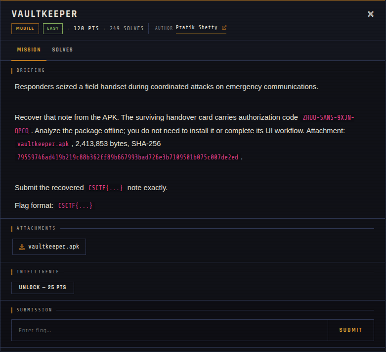

# VaultKeeper 🐾

| | |
|---|---|
| **Competition** | 2026 Chronos Security CTF |
| **Category** | Mobile |
| **Points** | 120 |
| **Author** | Pratik Shetty |
| **Difficulty** | Easy |
| **Solves** | 249 |

## Description

> Responders seized a field handset during coordinated attacks on emergency communications.
>
> Recover that note from the APK. The surviving handover card carries authorization code `ZHUU-5AN5-9XJN-QPCQ`. Analyze the package offline; you do not need to install it or complete its UI workflow. Attachment:
>
> `vaultkeeper.apk`, 2,413,853 bytes, SHA-256 `79559746ad419b219c88b362ff89b667993bad726e3b7109501b075c007de2ed`.
>
> Submit the recovered `CSCTF{...}` note exactly.

Flag format: `CSCTF{...}`

## Files

| File | Notes |
|------|-------|
| `files/vaultkeeper.apk` | 2,413,853 bytes · SHA-256 `79559746ad419b219c88b362ff89b667993bad726e3b7109501b075c007de2ed` |

## Remote service

None — offline static-analysis task (APK only, install/UI not required).

## Screenshots

## Solve

⚠️ Spoilers: notes

No solve script or flag was provided for this challenge yet.

---
Source: 2026 Chronos Security CTF
Archived by [StrayHound](https://strayhound.team) 🐾