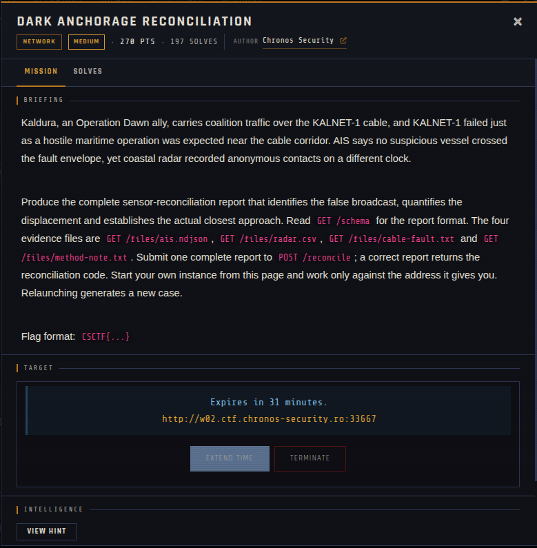
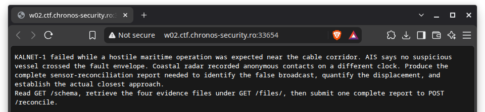

# Dark Anchorage Reconciliation 🐾

| | |
|---|---|
| **Competition** | CSCTF 2026: Total Warfare |
| **Category** | Network |
| **Points** | 270 |
| **Author** | Chronos Security |
| **Difficulty** | Medium |
| **Solves** | 197 |
| **Hint** | In-platform hint available (cost not shown) |

## Description

> Kaldura, an Operation Dawn ally, carries coalition traffic over the KALNET-1 cable, and KALNET-1 failed just as a hostile maritime operation was expected near the cable corridor. AIS says no suspicious vessel crossed the fault envelope, yet coastal radar recorded anonymous contacts on a different clock.
>
> Produce the complete sensor-reconciliation report that identifies the false broadcast, quantifies the displacement and establishes the actual closest approach. Read `GET /schema` for the report format. The four evidence files are `GET /files/ais.ndjson`, `GET /files/radar.csv`, `GET /files/cable-fault.txt` and `GET /files/method-note.txt`. Submit one complete report to `POST /reconcile`; a correct report returns the reconciliation code. Start your own instance from this page and work only against the address it gives you. Relaunching generates a new case.

Flag format: `CSCTF{...}`

## Files

| File | Notes |
|------|-------|
| `files/ais.ndjson` | 260,690 bytes · SHA-256 `4c14d6c403eaca0e546eca690e108df7212d97971b78b4dddc90ccadc187a149` |
| `files/radar.csv` | 100,195 bytes · SHA-256 `ca5a1742fea733cd08bb750b2749963e8f5aa127c6b50881256f4dd871070b4d` |
| `files/schema.json` | 1,518 bytes · SHA-256 `854a443045c456dc02d0b03897df98144aebfb22dcb7ba8759c12340facff96a` — submission schema (served live at `GET /schema`) |

⚠️ Per the brief, the live instance also served `files/cable-fault.txt` and `files/method-note.txt` generated per-case on launch — those weren't in the material you sent, so they're not archived here.

## Remote service

Per-team ephemeral instance (e.g. `http://w02.ctf.chronos-security.ro:33667`), offline now since the event/instance has ended. `GET /schema` for the report format, evidence served at `GET /files/...`, submit to `POST /reconcile`.

## Screenshots

---
Source: CSCTF 2026: Total Warfare
Archived by [StrayHound](https://strayhound.team) 🐾
