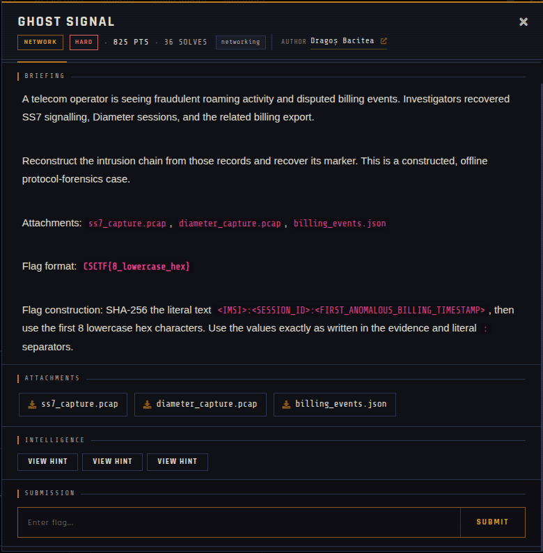

# Ghost Signal 🐾

| | |
|---|---|
| **Competition** | CSCTF 2026: Total Warfare |
| **Category** | Network |
| **Points** | 825 |
| **Author** | Dragoș Bacitea |
| **Difficulty** | Hard |
| **Solves** | 36 |
| **Hint** | 3 in-platform hints available (cost not shown) |

Tags: networking

## Description

> A telecom operator is seeing fraudulent roaming activity and disputed billing events. Investigators recovered SS7 signalling, Diameter sessions, and the related billing export.
>
> Reconstruct the intrusion chain from those records and recover its marker. This is a constructed, offline protocol-forensics case.
>
> Attachments: `ss7_capture.pcap`, `diameter_capture.pcap`, `billing_events.json`

Flag format: `CSCTF{8_lowercase_hex}`

Flag construction: SHA-256 the literal text `<IMSI>:<SESSION_ID>:<FIRST_ANOMALOUS_BILLING_TIMESTAMP>`, then use the first 8 lowercase hex characters. Use the values exactly as written in the evidence and literal `:` separators.

## Files

| File | Notes |
|------|-------|
| `files/ss7_capture.pcap` | 10,304 bytes · SHA-256 `2166a8ff5f0480d925be43d15284a77d823ab3756821c5ce8399ee60fe142d44` — M3UA/SCCP/TCAP/GSM-MAP over SCTP |
| `files/diameter_capture.pcap` | 8,708 bytes · SHA-256 `3730d26f4d4b2be8208c48b44fe457035bacbace090c6aa5d19f478f2dd27ae4` — Diameter over SCTP (3GPP Cx interface) |
| `files/billing_events.json` | 11,574 bytes · SHA-256 `cfdc680eee562efc28e9ab57281d0fcb7a0e5cbf18a2289634d0776e9ca855ae` |

## Remote service

None — offline protocol-forensics task.

## Screenshots

---
Source: CSCTF 2026: Total Warfare
Archived by [StrayHound](https://strayhound.team) 🐾
