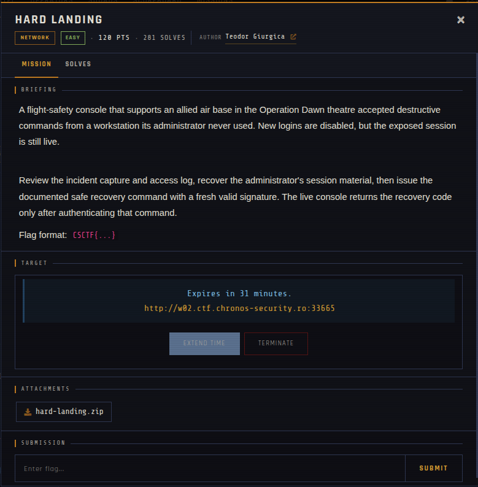
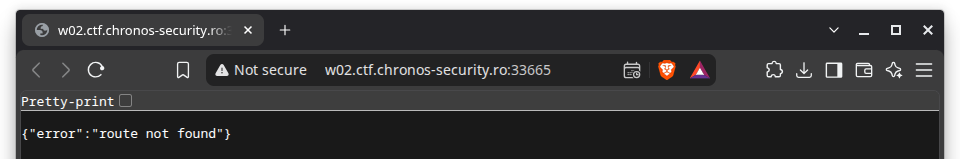

# Hard Landing 🐾

| | |
|---|---|
| **Competition** | CSCTF 2026: Total Warfare |
| **Category** | Network |
| **Points** | 120 |
| **Author** | Teodor Giurgica |
| **Difficulty** | Easy |
| **Solves** | 281 |

## Description

> A flight-safety console that supports an allied air base in the Operation Dawn theatre accepted destructive commands from a workstation its administrator never used. New logins are disabled, but the exposed session is still live.
>
> Review the incident capture and access log, recover the administrator's session material, then issue the documented safe recovery command with a fresh valid signature. The live console returns the recovery code only after authenticating that command.

Flag format: `CSCTF{...}`

## Files

| File | Notes |
|------|-------|
| `files/hard-landing.zip` | 4,579 bytes · SHA-256 `4e3b12e29944987e5a282941bcbf116116601abca8b96a04297b816f142863b0` — incident capture + access log |

## Remote service

Per-team ephemeral instance (e.g. `http://w02.ctf.chronos-security.ro:33665`), offline now since the event/instance has ended.

## Screenshots

---
Source: CSCTF 2026: Total Warfare
Archived by [StrayHound](https://strayhound.team) 🐾
