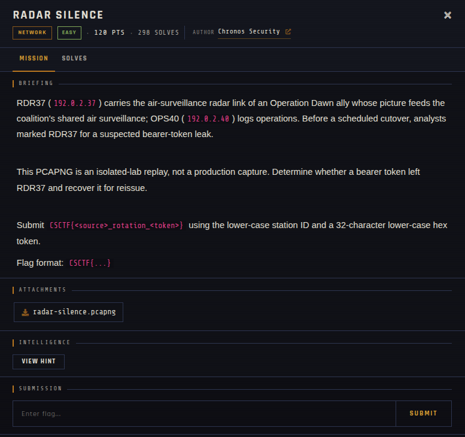

# Radar Silence 🐾

| | |
|---|---|
| **Competition** | CSCTF 2026: Total Warfare |
| **Category** | Network |
| **Points** | 120 |
| **Author** | Chronos Security |
| **Difficulty** | Easy |
| **Solves** | 298 |
| **Hint** | In-platform hint available (cost not shown) |

## Description

> RDR37 (`192.0.2.37`) carries the air-surveillance radar link of an Operation Dawn ally whose picture feeds the coalition's shared air surveillance; OPS40 (`192.0.2.40`) logs operations. Before a scheduled cutover, analysts marked RDR37 for a suspected bearer-token leak.
>
> This PCAPNG is an isolated-lab replay, not a production capture. Determine whether a bearer token left RDR37 and recover it for reissue.
>
> Submit `CSCTF{<source>_rotation_<token>}` using the lower-case station ID and a 32-character lower-case hex token.

Flag format: `CSCTF{...}`

## Files

| File | Notes |
|------|-------|
| `files/radar-silence.pcapng` | 4,052 bytes · SHA-256 `3de067f6cc66b7dd42cbfa072580b2f826b8ff453f7122c9345292a9d155ea53` — isolated-lab replay, not a production capture |

## Remote service

None — offline packet-analysis task.

## Screenshots

---
Source: CSCTF 2026: Total Warfare
Archived by [StrayHound](https://strayhound.team) 🐾
