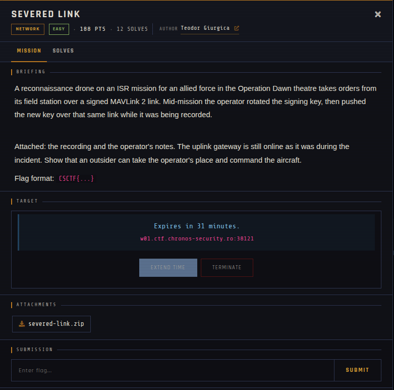

# Severed Link 🐾

| | |
|---|---|
| **Competition** | CSCTF 2026: Total Warfare |
| **Category** | Network |
| **Points** | 188 |
| **Author** | Teodor Giurgica |
| **Difficulty** | Easy |
| **Solves** | 12 |

## Description

> A reconnaissance drone on an ISR mission for an allied force in the Operation Dawn theatre takes orders from its field station over a signed MAVLink 2 link. Mid-mission the operator rotated the signing key, then pushed the new key over that same link while it was being recorded.
>
> Attached: the recording and the operator's notes. The uplink gateway is still online as it was during the incident. Show that an outsider can take the operator's place and command the aircraft.

Flag format: `CSCTF{...}`

## Files

| File | Notes |
|------|-------|
| `files/severed-link.zip` | 5,953 bytes · SHA-256 `fe8424c74a7f81a589581caa5ee3f99d91e4b9dab15376fd922b563afce87e64` — MAVLink 2 recording + operator's notes |

## Remote service

Per-team ephemeral instance (e.g. `w01.ctf.chronos-security.ro:30121`), offline now since the event/instance has ended.

## Screenshots

---
Source: CSCTF 2026: Total Warfare
Archived by [StrayHound](https://strayhound.team) 🐾
