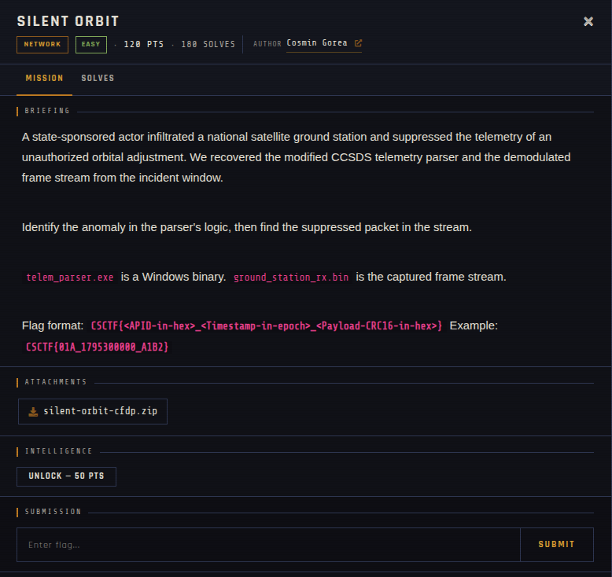

# Silent Orbit 🐾

| | |
|---|---|
| **Competition** | CSCTF 2026: Total Warfare |
| **Category** | Network |
| **Points** | 120 |
| **Author** | Cosmin Gorea |
| **Difficulty** | Easy |
| **Solves** | 180 |
| **Hint** | In-platform hint available for 50 pts |

## Description

> A state-sponsored actor infiltrated a national satellite ground station and suppressed the telemetry of an unauthorized orbital adjustment. We recovered the modified CCSDS telemetry parser and the demodulated frame stream from the incident window.
>
> Identify the anomaly in the parser's logic, then find the suppressed packet in the stream.
>
> `telem_parser.exe` is a Windows binary. `ground_station_rx.bin` is the captured frame stream.

Flag format: `CSCTF{<APID-in-hex>_<Timestamp-in-epoch>_<Payload-CRC16-in-hex>}` — example: `CSCTF{01A_1795300000_A1B2}`

## Files

| File | Notes |
|------|-------|
| `files/silent-orbit-cfdp.zip` | 3,355 bytes · SHA-256 `26a17bea5fd954ba796c7f35238e69e8728544b7cb32c030a8b0a8d4160fa4e4` — per the brief, contains `telem_parser.exe` (Windows binary) and `ground_station_rx.bin` (captured frame stream) |

## Remote service

None — offline static-analysis task.

## Screenshots

---
Source: CSCTF 2026: Total Warfare
Archived by [StrayHound](https://strayhound.team) 🐾
