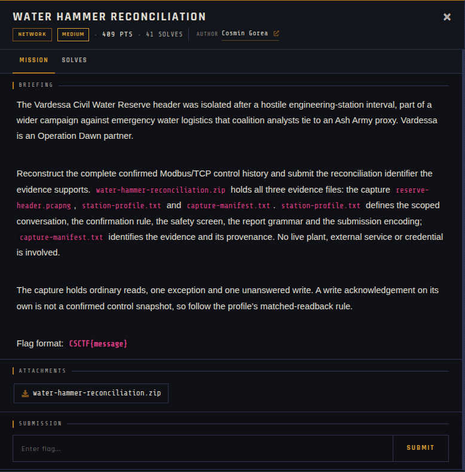

# Water Hammer Reconciliation 🐾

| | |
|---|---|
| **Competition** | CSCTF 2026: Total Warfare |
| **Category** | Network |
| **Points** | 409 |
| **Author** | Cosmin Gorea |
| **Difficulty** | Medium |
| **Solves** | 41 |

## Description

> The Vardessa Civil Water Reserve header was isolated after a hostile engineering-station interval, part of a wider campaign against emergency water logistics that coalition analysts tie to an Ash Army proxy. Vardessa is an Operation Dawn partner.
>
> Reconstruct the complete confirmed Modbus/TCP control history and submit the reconciliation identifier the evidence supports. `water-hammer-reconciliation.zip` holds all three evidence files: the capture `reserve-header.pcapng`, `station-profile.txt` and `capture-manifest.txt`. `station-profile.txt` defines the scoped conversation, the confirmation rule, the safety screen, the report grammar and the submission encoding; `capture-manifest.txt` identifies the evidence and its provenance. No live plant, external service or credential is involved.
>
> The capture holds ordinary reads, one exception and one unanswered write. A write acknowledgement on its own is not a confirmed control snapshot, so follow the profile's matched-readback rule.

Flag format: `CSCTF{message}`

## Files

| File | Notes |
|------|-------|
| `files/water-hammer-reconciliation.zip` | 16,926 bytes · SHA-256 `6b6bd7d67776adb652a12ad448d89c6281c62aeab43cb8e0c6b680d88cf00ec5` — per the brief, contains `reserve-header.pcapng`, `station-profile.txt` and `capture-manifest.txt` |

## Remote service

None — fully offline evidence package (no live plant, external service or credential involved, per the brief).

## Screenshots

---
Source: CSCTF 2026: Total Warfare
Archived by [StrayHound](https://strayhound.team) 🐾
