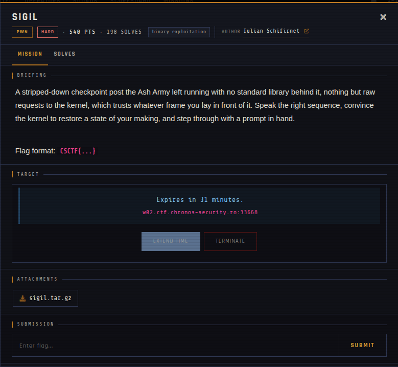
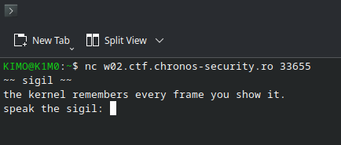

# Sigil 🐾

| | |
|---|---|
| **Competition** | 2026 Chronos Security CTF |
| **Category** | Pwn |
| **Points** | 540 |
| **Author** | Iulian Schifirnet |
| **Difficulty** | Hard |
| **Solves** | 198 |

## Description

> A stripped-down checkpoint post the Ash Army left running with no standard library behind it, nothing but raw requests to the kernel, which trusts whatever frame you lay in front of it. Speak the right sequence, convince the kernel to restore a state of your making, and step through with a prompt in hand.

Flag format: `CSCTF{...}`

Tags: binary exploitation

## Files

| File | Notes |
|------|-------|
| `files/sigil.tar.gz` | Archive (1,410 bytes) containing `sigil` (9,456 bytes, the challenge binary) and `sigil.c` (946 bytes, source) |

## Remote service

Per-team ephemeral instance (e.g. `w02.ctf.chronos-security.ro:<port>`), offline now since the event/instance has ended.

## Screenshots

## Solve

⚠️ Spoilers: solve script and notes

- Solve scripts: [`solve/solve.py`](solve/solve.py) (pwntools) and [`solve/solve_nopwn.py`](solve/solve_nopwn.py) (stdlib-only, no pwntools/unicorn/cmake needed)
- Bug: `listen()` reads 0x400 bytes into a 0x40-byte stack buffer, no canary, no PIE, no libc. `sys3(nr,a,b,c)` reloads its 4 args from `[rbp-0x18/0x20/0x28/0x30]` right before `syscall`, so controlling RBP gives an arbitrary 3-arg syscall without needing to know any ASLR'd address — staged through the binary's own fixed `.bss` address. Two-stage smash: first turns the return into a second fixed-address read, then that data lands on the "reload regs + syscall" gadget with `execve("/bin/sh", NULL, NULL)`.
- Flag: `CSCTF{sXt4aRdrS76BXtBaJU8e5dF7}`
- Flag screenshot: [`images/03-flag-captured.png`](images/03-flag-captured.png)

⚠️ Both solve scripts have the event's remote `HOST`/`PORT` hardcoded (`w02.ctf.chronos-security.ro`, port from the nc screenshot). That instance is gone, so it's harmless to keep, but you may want to replace it with a placeholder/`argv` before committing if you'd rather not publish the exact subdomain.

---
Source: 2026 Chronos Security CTF
Archived by [StrayHound](https://strayhound.team) 🐾